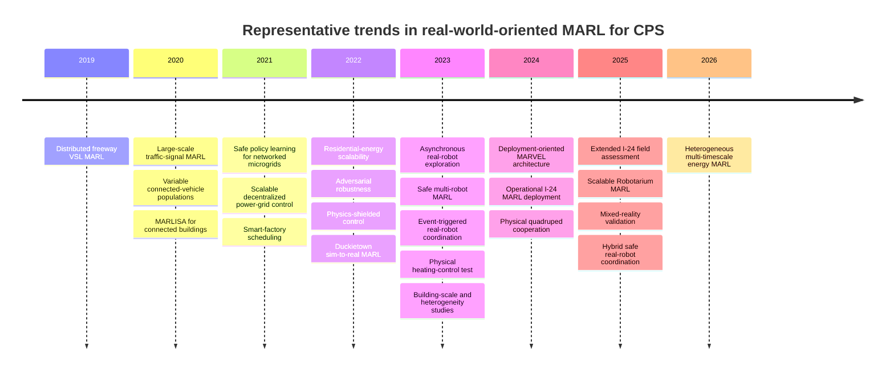

# Real-World MARL in Distributed Cyber-Physical Systems

## Executive summary

This scoping review examined primary research on **multi-agent reinforcement learning applied to distributed cyber-physical systems**, with particular attention to the four issues that matter for the thesis: **dynamic heterogeneity, scalability, safety/robustness, and deployability**.

The most important conclusion is that the literature does **not** support four simple claims such as “MARL does not scale”, “MARL cannot be made safe”, “dynamic agent teams have not been studied”, or “MARL has never been deployed in the real world”. There are clear counterexamples to each of these statements. For example, MARL-based variable-speed-limit control has been deployed on a 17-mile section of Interstate 24 using 67 controllers; the initial field paper reports about 10 million decisions over 8 million trips, while a subsequent assessment of the same deployment reports approximately 35 million decisions over 28 million trips during six months of operation. citeturn26search0turn26search1 Real-robot MARL studies have explicitly considered asynchronous execution, robot loss, varying team size, time-varying communication graphs, and zero-shot transfer to physical platforms. citeturn26search2turn26search3

The more defensible conclusion—and the one I recommend for Chapter 2—is that the remaining problems are **integration gaps**. Individual aspects have been addressed in isolation or under controlled assumptions, but much less evidence exists for systems that simultaneously combine heterogeneous agents, changing availability, growing scale, imperfect communication, physical constraints, uncertainty, failures, and a lifecycle that extends from training to sustained operation.

The curated evidence matrix contains **30 primary-study records** published between 2019 and 2026: 13 in energy, 9 in transport, 6 in robotics, and 2 in industrial applications. Eighteen provide simulation-only evidence, ten include a physical testbed, and two describe operational deployment. Importantly, those two operational papers describe different stages of the **same I-24 deployment programme**, so this corpus contains one clearly documented independent operational MARL deployment lineage rather than two. This distinction is essential: counting publications would otherwise make field deployment appear more common than the evidence supports. citeturn26search0turn26search1

The four residual gaps can therefore be stated as follows:

| Thesis issue | Strength of residual gap | Review conclusion |
|---|---:|---|
| **Dynamic heterogeneity** | **Strong**, when formulated jointly | Variable team sizes, dropout, heterogeneous participants, and time-varying graphs have individually been demonstrated; persistent operation with heterogeneous capabilities and online joining, leaving, or role changes remains weakly represented, particularly in operational systems. |
| **Scalability** | **Moderate** | Meaningful scaling results exist. The unresolved problem is simultaneous scaling across agent count, heterogeneity, communication, computation, environment complexity, and reconfiguration. |
| **Safety / Robustness** | **Moderate** | Explicit constraints, shields, adversarial training, delay-aware control, action masking, and runtime guards already exist. Systematic joint evaluation across uncertainty, faults, reconfiguration, and train-to-operation shift remains limited. |
| **Deployability** | **Strong** | Real deployment is demonstrably possible, but sustained operational MARL remains exceptional; end-to-end lifecycle evidence is much scarcer than simulation or laboratory validation. |

This is a stronger basis for the thesis than claiming that the four subjects are untouched. It positions the contribution as addressing the difficult transition from **isolated solutions for individual challenges** to an **integrated approach for MARL-based control in real-world distributed CPS**.

The complete evidence matrix, bibliography, protocol, and summary are available here:

[Download the full CSV evidence matrix](sandbox:/mnt/data/real_world_marl_scoping_review_evidence_matrix.csv)  
[Download the TSV evidence matrix](sandbox:/mnt/data/real_world_marl_scoping_review_evidence_matrix.tsv)  
[Download the top-30 study table](sandbox:/mnt/data/real_world_marl_top30_summary.csv)  
[Download the prioritized BibTeX file](sandbox:/mnt/data/real_world_marl_prioritized_studies.bib)  
[Download the PDF review summary](sandbox:/mnt/data/real_world_marl_scoping_review_summary.pdf)

## Search protocol and corpus construction

The review was conducted on **12 August 2026** as a **curated scoping review** rather than a PRISMA-complete systematic review. That distinction is deliberate.

Primary-source discovery and verification were performed through openly accessible material from **IEEE Xplore, ACM Digital Library, arXiv, publisher platforms, institutional/author project pages, and official software repositories**. Publicly indexable Google Scholar material was also used for citation chasing. Authenticated result-level access to **Scopus and Web of Science was not available in this research environment**, so I have not invented database hit counts, duplicate-removal counts, or a PRISMA flow diagram. Instead, the exact Boolean queries needed to reproduce that stage through FEUP institutional access are provided below and in the downloadable protocol.

[Download the complete search protocol and Mermaid timeline](sandbox:/mnt/data/real_world_marl_scoping_review_protocol_and_timeline.md)

The temporal range was **2015 to 12 August 2026**. In practice, the retained corpus begins in 2019 because earlier papers found during screening did not provide sufficiently direct evidence for the four review dimensions to justify inclusion in this focused corpus.

The search was deliberately broader than energy because the thesis concerns a general CPS problem even though Renewable Energy Communities are its main application domain. Search terms therefore combined three groups:

**MARL terms:** “multi-agent reinforcement learning”, “multiagent reinforcement learning”, MARL, MADRL, MAPPO, multi-agent actor-critic.

**CPS/domain terms:** cyber-physical systems, distributed control, robots, autonomous vehicles, traffic, transport, power grid, microgrid, buildings, energy, manufacturing, industrial systems.

**Evidence/gap terms:** deployment, real-world, field, operational, testbed, hardware, sim-to-real, heterogeneous, dynamic population, scalable, communication, safety, robust, resilience.

For an institutional rerun, the principal Scopus expression is:

```text
TITLE-ABS-KEY(
  ("multi-agent reinforcement learning"
   OR "multiagent reinforcement learning"
   OR MARL OR MADRL)
  AND
  ("cyber-physical" OR robot* OR traffic OR transport
   OR "power grid" OR microgrid* OR building*
   OR energy OR manufacturing OR industrial)
  AND
  (deploy* OR "real-world" OR testbed OR hardware
   OR "sim-to-real" OR scalab* OR heterogene*
   OR dynamic OR safety OR robust*)
)
AND PUBYEAR > 2014
```

The corresponding Web of Science Core Collection expression is:

```text
TS=(
  ("multi-agent reinforcement learning"
   OR "multiagent reinforcement learning"
   OR MARL OR MADRL)
  AND
  ("cyber-physical" OR robot* OR traffic OR transport
   OR "power grid" OR microgrid* OR building*
   OR energy OR manufacturing OR industrial)
  AND
  (deploy* OR "real-world" OR testbed OR hardware
   OR "sim-to-real" OR scalab* OR heterogene*
   OR dynamic OR safety OR robust*)
)
```

The IEEE Xplore query was structured around the same concepts:

```text
("All Metadata":"multi-agent reinforcement learning"
 OR "All Metadata":"multiagent reinforcement learning")
AND
("All Metadata":"real-world"
 OR "All Metadata":deployment
 OR "All Metadata":testbed
 OR "All Metadata":scalability
 OR "All Metadata":safety
 OR "All Metadata":heterogeneous)
```

The ACM Digital Library query is:

```text
[All: "multi-agent reinforcement learning"]
AND
([All: robot] OR [All: traffic] OR [All: energy]
 OR [All: building] OR [All: manufacturing])
AND
([All: deployment] OR [All: testbed]
 OR [All: "real-world"] OR [All: scalability]
 OR [All: safety])
```

For Google Scholar, several smaller phrase searches are preferable to one very long query because they expose different ranking neighborhoods:

```text
"multi-agent reinforcement learning" "field deployment"
"multi-agent reinforcement learning" "real robot"
"multi-agent reinforcement learning" "power grid" safe
"multi-agent reinforcement learning" scalable buildings
"multi-agent reinforcement learning" heterogeneous dynamic agents
"multi-agent reinforcement learning" "sim-to-real"
```

A study was included when it was English-language primary research, explicitly involved at least two learning/control agents within a MARL formulation, modelled a physical or cyber-physical control problem, and provided evidence relevant to at least one of the four target dimensions. High-fidelity simulation studies were retained when they provided unusually relevant evidence—for example, an explicit 2-to-64-agent scalability study or a constrained power-system formulation—even though they did not contain physical deployment.

Surveys and tutorials were excluded as evidence-matrix rows; pure game benchmarks were excluded unless directly connected to physical control; non-RL distributed optimisation was excluded; single-agent RL controlling many actuators was not reclassified as MARL; conceptual proposals without a CPS experiment were excluded; and duplicate preprint/journal versions were collapsed. Separate papers from the same deployment were retained only where they documented materially different stages of that deployment, and are marked as belonging to a common lineage.

The screening logic was therefore:

```text
Discovery
   ↓
Explicit MARL?
   ↓
Physical/CPS control relevance?
   ↓
Primary experimental evidence?
   ↓
Relevant to at least one target gap?
   ↓
Primary-source verification
   ↓
Evidence extraction
   ↓
Counterexample pass
   ↓
Deployment-lineage check
```

This final **counterexample pass** was important. Instead of searching only for papers that support the thesis gaps, the review deliberately searched for work that might falsify them. That is why studies such as the I-24 deployment, physical Robotarium experiments, safe power-grid MARL, SCALEX, and variable-population robotics were retained prominently. citeturn26search0turn26search2turn17search0turn19search1

## Taxonomy and evidence landscape

The corpus is better understood as a progression of **evidence types** rather than only a list of algorithms.

**Algorithm-centric CPS simulation** is the largest class. These studies normally begin with a concrete physical system—buildings, microgrids, traffic networks, robots, manufacturing systems—but evaluate the policy exclusively within simulation. This class is scientifically useful because it permits repeated experiments and large-scale stress testing, but it provides little direct evidence about real sensing, actuator interfaces, network faults, runtime timing, deployment procedures, or long-term operation. MARLISA, PowerNet, and several building-demand-response studies sit mainly in this class. citeturn18search3turn22search0turn18search2

**Scalability and heterogeneity studies** deliberately relax assumptions that are common in simpler MARL experiments. SCALEX, for example, explicitly compares centralized and decentralized SAC configurations across **2 to 64 buildings**, providing unusually direct agent-count evidence in the building-control literature. citeturn17search0turn17search2 Charbonnier et al. address distributed residential flexibility under partial observability with heterogeneous assets such as EVs and flexible thermal loads, while avoiding direct sharing of private prosumer information. citeturn22search5turn22search13 Wu et al. explicitly frame building-community control as a heterogeneous MARL problem. citeturn17search1turn17search3 In robotics, Sebastián et al. go further by using a policy representation designed for time-varying interaction graphs and report physical Robotarium experiments up to 16 robots, alongside simulations with teams substantially larger than those encountered during training. citeturn26search2turn26search8

**Safe and robust MARL** forms a distinct body of work rather than an empty research area. Zhang et al. formulate safe policy learning for networked microgrids with AC power-flow and operational constraints embedded in distributed learning. citeturn19search1 Chen et al. use a physics-based shield for active voltage control so that learned actions remain constrained by electrical operating requirements. citeturn22search3 Gu et al. formulate safe multi-agent control using constrained policy optimisation and provide safe multi-agent benchmark environments. citeturn25search7turn25search19 Guo et al. explicitly study voltage safety together with communication delay, while Zeng et al. investigate adversarial attacks against MARL-based demand response. citeturn18search0turn22search6

These papers matter because they change how the thesis should formulate RQ3. The research gap is **not** “there are no methods for safe MARL”. Rather, safety solutions tend to address selected constraints or disturbances, whereas the thesis is concerned with the broader operational combination of physical constraints, uncertainty, faults, dynamic reconfiguration, communication effects, and the transition from training conditions to runtime conditions.

**Physical testbed and sim-to-real MARL** represents the next evidence tier. Candela et al. train autonomous-driving MARL policies in simulation using domain randomization and transfer them to Duckietown robots, providing a concrete example that MARL sim-to-real transfer is possible. citeturn15search3turn15search7 Yu et al. address a particularly practical assumption: robots do not necessarily complete actions synchronously in the real world. Their asynchronous formulation includes action-delay randomization, team-size-invariant policies, robot-loss handling, low-dimensional communication, and real-robot experiments; they report more than a 10% reduction in actual exploration time compared with synchronous approaches. citeturn26search3 Shibata et al. combine event-triggered communication and consensus-based control and transfer the approach to real cooperative-transport robots, including evidence for agent counts different from those used during training. citeturn16search0turn16search12

Energy also contains physical evidence. Blad et al. evaluate an offline-trained multi-agent heating-control algorithm in a laboratory physical system rather than stopping at simulation, although the experiment is small and does not constitute deployment in a continuously occupied operational building. citeturn18search1turn18search5 This distinction between **testbed evidence** and **operational evidence** needs to remain explicit throughout the thesis.

**Deployment-enabling system work** occupies the space between a laboratory experiment and operational control. MARVEL is particularly useful here because its contribution is not just another VSL policy: it documents the engineering needed to move MARL-based control closer to deployment, including operational interfaces and safeguards. citeturn25search1turn25search13 Mixed-reality digital twins provide another intermediate layer, allowing physical and simulated agents to coexist during validation instead of treating sim-to-real as a single abrupt transition. citeturn12search3turn12search7

Finally, **operational field control** is represented most strongly by the I-24 programme. The 2024 paper reports deployment of a simulation-trained MARL VSL system over **17 miles and 67 VSL controllers**, with invalid-action masking and several safety guards. Through April 2024 it had made about **10 million decisions over 8 million trips**, with the MARL policy operating without guard intervention for up to 98% of the reported period. citeturn26search0 The subsequent assessment reports operation beginning on **8 March 2024**, approximately **35 million decisions over 28 million trips within six months**, and comparison against the preceding non-RL VSL controller. It reports a 14% improvement in warning accuracy and a 75% reduction in response delay for non-recurrent congestion, together with preliminary crash-related indicators; the authors also released the deployed controller as open source. citeturn26search1

Those two papers are a powerful counterexample to an absolute deployability claim, but they must be interpreted correctly: they are **not two independent examples of MARL reaching public infrastructure**. They document successive stages of one unusually mature programme.

The resulting progression is visible in the research timeline:



The milestones above are representative examples from the curated corpus rather than a claim that each year contained only those developments. The strongest trend is a gradual movement from performance-centred simulation toward explicit robustness, physical transfer, deployment infrastructure, and—in a very small number of cases—operational execution. citeturn26search0turn26search1turn26search2turn26search3

The coded corpus by domain and deployment tier is shown below. Because this is a curated rather than census-like review, the bars should be interpreted descriptively, not as estimates of the absolute distribution of the entire MARL literature.


## Curated top studies and evidence matrix

The complete CSV contains one row per primary study and all requested extraction fields: bibliographic metadata, study type, domain, heterogeneity, population dynamics, observability, communication model, training paradigm, safety/robustness evaluation, deployment level, scalability evidence, data/code availability, main findings, limitations, and relevance to each thesis gap.

The following table gives the condensed top-30 view. “Operational” means the algorithm was actually used in a field control system; “testbed” denotes physical execution without claiming sustained operational use.

| Priority | Primary study | Domain | Evidence | Most useful for |
|---:|---|---|---|---|
| **1** | Zhang et al., *Field Deployment of MARL Based VSL Controllers* (2024) citeturn26search0 | Transport | **Operational** | Deployability, scale, safety |
| **2** | Zhang et al., *Real-World Deployment and Assessment…* (2025) citeturn26search1 | Transport | **Operational** | Sustained operation, evaluation |
| **3** | Sebastián et al., *Physics-Informed MARL for Distributed Multi-Robot Problems* (2025) citeturn26search2turn26search8 | Robotics | **Testbed** | Scale, variable topology, sim-to-real |
| **4** | Zhang et al., *MARVEL* (2024) citeturn25search1turn25search13 | Transport | Testbed/deployment engineering | Deployment pipeline, safety |
| **5** | Yu et al., *Asynchronous MARL for Multi-Robot Exploration* (2023) citeturn26search3 | Robotics | **Testbed** | Asynchrony, dropout, deployment |
| **6** | Candela et al., *Transferring MARL Policies for Autonomous Driving using Sim-to-Real* (2022) citeturn15search3turn15search7 | Transport | **Testbed** | Sim-to-real, domain randomization |
| **7** | Amir et al., *ReCoDe* (2025) citeturn24search3turn24search7 | Robotics | **Testbed** | Hybrid safety, real robots |
| **8** | Shibata et al., *Event-Triggered Communication and Consensus-Based Control* (2023) citeturn16search0turn16search12 | Robotics | **Testbed** | Communication, variable team size |
| **9** | Su et al., *Dynamic Queue-Jump Lane for Emergency Vehicles* (2020) citeturn15search1 | Transport | Simulation | Variable population, partial connectivity |
| **10** | Gu et al., *Safe MARL for Multi-Robot Control* (2023) citeturn25search7turn25search19 | Robotics | Simulation | Explicit constrained MARL |
| **11** | Zhang et al., *Cooperative MARL for Large Scale VSL Control* (2023) citeturn23search5 | Transport | Simulation | Scale, parameter sharing, robustness |
| **12** | Chu et al., *Multi-Agent Deep RL for Large-Scale Traffic Signal Control* (2020) citeturn13view2 | Transport | Simulation | Large networks, local information |
| **13** | Zhang et al., *Safe Policy Learning for Networked Microgrids* (2021) citeturn19search1 | Energy | Simulation | Physical constraints, distributed safety |
| **14** | Samak et al., *Mixed-Reality Digital Twins for MARL Sim2Real* (2025) citeturn12search3turn12search7 | Transport | **Testbed** | Validation between simulation and reality |
| **15** | Chen et al., *PowerNet* (2021/2022) citeturn22search0turn22search8 | Energy | Simulation | Locality, communication, scalability |
| **16** | Feng et al., *Multi-Agent Loco-Manipulation* (2024/25) citeturn24search2 | Robotics | **Testbed** | Hierarchical MARL, real robots |
| **17** | Charbonnier et al., *Scalable MARL for Residential Energy Flexibility* (2022) citeturn22search5turn22search13 | Energy | Simulation | Heterogeneous assets, distributed scale |
| **18** | Wang et al., *Cooperative Speed Limit Control using Distributed RL* (2019) citeturn23search1 | Transport | Simulation | Distributed traffic control |
| **19** | Vázquez-Canteli et al., *MARLISA* (2020) citeturn18search3 | Energy | Simulation | Connected buildings, coordination |
| **20** | Chen et al., *Physics-Shielded MARL for Safe Active Voltage Control* (2022/23) citeturn22search3 | Energy | Simulation | Physics shield, safety |
| **21** | Blad et al., *Laboratory Test of Offline-Trained MARL for Heating Systems* (2023) citeturn18search1turn18search5 | Energy | **Testbed** | Physical energy-control evidence |
| **22** | Guo et al., *Safe Decentralized Control Considering Communication Delay* (2023) citeturn18search0 | Energy | Simulation | Safety plus communication delay |
| **23** | Zeng et al., *Resilience against Adversarial Attacks* (2022) citeturn22search6 | Energy | Simulation | Robustness/security disturbances |
| **24** | Xie et al., *Attention-Based MARL for Grid-Responsive Buildings* (2023) citeturn18search2 | Energy | Simulation | Selective coordination |
| **25** | Almilaify et al., *SCALEX* (2023) citeturn17search0turn17search2 | Energy | Simulation | Explicit 2–64-building scaling |
| **26** | Heterogeneous multi-timescale MARL for industrial microgrids (2026) citeturn3academia30 | Energy | Simulation | Heterogeneous roles and timing |
| **27** | Wu et al., *Heterogeneous MARL for Grid-Interactive Communities* (2023) citeturn17search1turn17search3 | Energy | Simulation | Explicit agent heterogeneity |
| **28** | Zhou et al., *MARL for Online Scheduling in Smart Factories* (2021) citeturn12search0 | Industrial | Testbed-oriented | Industrial CPS |
| **29** | Nweye et al., *Offline Training of MARL Agents for Grid-Interactive Buildings* (2022) citeturn17search4 | Energy | Simulation | Offline learning, deployment precursor |
| **30** | Malus et al., *Real-Time Order Dispatching for Autonomous Mobile Robots* (2020) citeturn24search0 | Industrial | Simulation | Industrial multi-agent scheduling |

Several patterns emerge from the extraction.

First, **heterogeneity is often environmental rather than architectural**. A paper may contain buildings with different load profiles or controllers installed at different network locations while still using one homogeneous policy class and a fixed agent set. This is not the same as supporting agents with fundamentally different observation spaces, action capabilities, operating timescales, or roles. MARLISA and PowerNet are useful examples of why this distinction matters. citeturn18search3turn22search0

Second, **dynamic assets are not necessarily dynamic agent populations**. An EV becoming unavailable, a production order arriving, or a load changing over time does not automatically mean that the learning architecture supports agents entering or leaving. The strongest studies retained for population dynamics explicitly vary the controlled vehicle population, lose robots, change team size, or modify interaction graphs. citeturn15search1turn26search3turn26search8 This distinction should also be preserved later in the thesis when discussing dynamic RECs.

Third, **scalability has several meanings**. SCALEX measures building-count scaling. citeturn17search0 PowerNet addresses information locality and communication. citeturn22search0 Sebastián et al. investigate generalization to larger robot teams and physical multi-robot execution. citeturn26search2turn26search8 The I-24 programme demonstrates operational scale through 67 simultaneously deployed controllers. citeturn26search0 None of these alone proves general “MARL scalability”; each establishes scalability along different dimensions.

Fourth, **safety mechanisms are frequently external or hybrid**. The I-24 deployment is an instructive example: the learned policy is supplemented by invalid-action masking and runtime safety guards rather than being trusted as an unconstrained neural controller. citeturn26search0turn26search1 The same broader pattern occurs with physics shields and expert-controller hybrids. citeturn22search3turn24search3 This supports a thesis architecture in which Safety is a property of the overall control stack, not necessarily something that one MARL algorithm must provide by itself.

## Gap assessment and counterexamples

The most useful outcome of the review is the ability to replace overly broad gap claims with statements that are much harder to challenge during a viva.

| Tempting claim | Assessment | Counterevidence | Defensible replacement |
|---|---|---|---|
| “MARL has not been deployed in real-world CPS.” | **False** | I-24 operational deployment. citeturn26search0turn26search1 | Operational deployments exist but remain exceptional and concentrated in a very small number of programmes. |
| “Dynamic MARL populations have not been studied.” | **False** | Varying connected-vehicle populations, robot loss, changing team sizes and time-varying graphs. citeturn15search1turn26search3turn26search8 | The joint problem of heterogeneous capabilities with persistent online reconfiguration is still weakly demonstrated, especially operationally. |
| “MARL does not scale.” | **Too strong** | 2–64 buildings, larger-than-training robot teams, 67 operational traffic controllers. citeturn17search0turn26search8turn26search0 | Scalability is demonstrated along individual dimensions; multi-dimensional scaling remains insufficiently established. |
| “Safety is ignored by MARL.” | **False** | Safe policy learning, constrained MARL, physics shields, delay-aware control, runtime guards. citeturn19search1turn25search7turn22search3turn18search0turn26search0 | Explicit safety mechanisms exist, but systematic safety and robustness assessment across real operational disturbances remains limited. |
| “Sim-to-real MARL has not been demonstrated.” | **False** | Duckietown, real exploration robots, cooperative transport, Robotarium, heating laboratory. citeturn15search3turn26search3turn16search0turn26search8turn18search1 | Physical transfer exists, but testbed validation should not be conflated with sustained operational deployment. |

**Dynamic heterogeneity — Strong residual gap.** The qualifier is essential. There is insufficient evidence for claiming that dynamic teams themselves are novel. Su et al. explicitly model a varying number of connected vehicles and changing connectivity penetration. citeturn15search1 Yu et al. design a team-size-invariant policy partly so the system can handle robot loss. citeturn26search3 Shibata et al. provide evidence with agent counts different from training, and Sebastián et al. explicitly target time-varying robot interaction graphs and teams larger than those used during training. citeturn16search0turn26search8

What remains substantially less established is the **joint case** needed by the thesis: agents that differ in physical capabilities, observations, actions or operating timescales; whose availability changes during operation; and for which joining, leaving or changing role must not require redesigning the whole controller. The review found targeted solutions for pieces of this problem, but not a mature body of operational evidence addressing the combination. This makes the gap strong **when stated in this precise form**.

**Scalability — Moderate residual gap.** The evidence is too strong to characterize scalability itself as unresolved. SCALEX explicitly evaluates 2–64 buildings. citeturn17search0 Charbonnier et al. design distributed energy control partly to avoid centralized growth and information sharing. citeturn22search5 Sebastián et al. report policies handling robot teams considerably larger than those used for training and physical experiments involving up to 16 robots. citeturn26search2turn26search8 The I-24 system provides stronger evidence of runtime scale with 67 field controllers. citeturn26search0

The residual gap is therefore **multi-dimensional scalability**. Increasing \(N\) while keeping agents homogeneous, communication ideal, models fixed, training resources unconstrained, and membership static establishes only one kind of scale. Real CPS can increase \(N\), diversity, information traffic, network uncertainty, computational burden and scenario complexity simultaneously. The thesis should investigate and report these dimensions separately rather than collapsing them into one statement such as “the approach is scalable”.

**Safety and Robustness — Moderate residual gap.** Safety is already an explicit topic in primary MARL research. Networked-microgrid policies have been trained with power-flow and operational constraints; physics shields have been used to constrain voltage-control actions; constrained multi-agent optimisation has been formalised for safe robot control; communication delay has been modelled in inverter control; and operational policies have been placed behind runtime guards. citeturn19search1turn22search3turn25search7turn18search0turn26search0 Robustness has likewise been studied against adversarial inputs, action delays, robot loss, communication disturbances and simulation-to-real mismatch. citeturn22search6turn26search3turn26search8turn26search0

The residual problem is that these dimensions are often assessed **one at a time**. A controller may be safe with respect to voltage bounds but not studied under agent loss; robust against adversarial observations but not deployed on physical hardware; or transferred to robots without a systematic fault campaign. RQ3 can therefore be defended as an integration and evaluation question: how to incorporate physical constraints and then systematically assess operation when uncertainty, faults, reconfiguration, communication effects, and training-to-runtime shift occur.

**Deployability — Strong residual gap.** This is the clearest gap, provided the thesis does not claim that deployment is absent. Physical testbeds have become increasingly visible across robotics, autonomous driving and building control. citeturn15search3turn26search3turn16search0turn18search1 The I-24 programme proves that operational MARL control is feasible at non-trivial scale. citeturn26search0turn26search1

But deployment involves more than executing `policy(observation)`. The I-24 work itself demonstrates why: the system needs interfaces to the traffic-management infrastructure, policy validation, action masking, safety guards and analysis of simulator-to-field mismatch. citeturn26search0turn26search5 MARVEL makes these deployment-engineering concerns an explicit subject of study rather than assuming that the trained controller can simply be copied to an operational system. citeturn25search1turn25search13 The broader lifecycle addressed by the thesis—reproducible training, validation, packaging, distributed deployment, monitoring, updating, rollback and failure recovery—remains far less developed in the reviewed MARL CPS literature than algorithm training itself.

These results suggest a particularly useful way to present the thesis:

> The research problem is not that no partial solutions exist. The problem is that **real-world distributed CPS require these properties together**.

That is a stronger and more credible scientific position.

## Chapter 2 citation priorities and suggested wording

For the actual Chapter 2, I would not cite all 30 papers with equal weight. A smaller set should carry the main argument, while the remainder supports tables and more specialised statements.

| Priority study | Why it deserves a prominent citation in Chapter 2 |
|---|---|
| **Zhang et al. 2024 — Field Deployment** (`Zhang2024FieldDeploymentVSL`) | The strongest counterexample to an absolute deployability gap: 67 controllers on public infrastructure, with explicit runtime safety mechanisms. citeturn26search0 |
| **Zhang et al. 2025 — Real-World Assessment** (`Zhang2025RealWorldVSL`) | Demonstrates sustained operation and evaluation beyond the initial deployment; must be identified as the same deployment lineage. citeturn26search1 |
| **Sebastián et al. 2025** (`Sebastian2025PhysicsInformed`) | Excellent cross-domain evidence for variable team scale, time-varying information topology, structured policies, and physical multi-robot evaluation. citeturn26search2turn26search8 |
| **Yu et al. 2023** (`Yu2023AsyncMARL`) | Particularly relevant to real CPS because it abandons the idealised synchronous-action assumption and treats action delay and robot loss. citeturn26search3 |
| **Zhang et al. 2024 — MARVEL** (`Zhang2024MARVEL`) | Bridges the algorithm/deployment boundary and is highly relevant to the thesis's Deployability argument. citeturn25search1 |
| **Candela et al. 2022** (`Candela2022SimToReal`) | Clean sim-to-real counterexample in autonomous driving using a real physical platform and domain randomization. citeturn15search3 |
| **Shibata et al. 2023** (`Shibata2023EventTriggered`) | Useful for communication scalability and variable team size with real robots. citeturn16search0 |
| **Gu et al. 2023** (`Gu2023SafeMARL`) | Strong evidence that explicit safe-MARL formulations and reusable constrained benchmarks already exist. citeturn25search7 |
| **Zhang et al. 2021 — networked microgrids** (`Zhang2021SafeMicrogrids`) | Energy-domain counterexample to claims that MARL does not incorporate physical feasibility. citeturn19search1 |
| **Chen et al. — PowerNet** (`Chen2022PowerNet`) | Relevant for locality, communication and scalable distributed grid control. citeturn22search0 |
| **Charbonnier et al. 2022** (`Charbonnier2022ScalableEnergy`) | Important bridge to REC-like settings: partial observability, heterogeneous flexible resources, distributed decisions and scalability. citeturn22search5 |
| **Almilaify et al. — SCALEX** (`Almilaify2023SCALEX`) | Gives unusually explicit empirical scalability evidence—2 to 64 buildings—so it is important both as evidence and as a counterexample. citeturn17search0 |
| **Blad et al. 2023** (`Blad2023Laboratory`) | Valuable because it moves energy MARL onto a physical heating setup rather than another purely simulated benchmark. citeturn18search1 |
| **Guo et al. 2023** (`Guo2023SafeInverter`) | Explicitly combines communication delay and safe voltage operation, useful for RQ3. citeturn18search0 |
| **Chen et al. — Physics-Shielded MARL** (`Chen2023PhysicsShielded`) | Demonstrates the architectural idea that a learned policy can be combined with a physics-based action-safety layer. citeturn22search3 |
| **Wu et al. 2023** (`Wu2023HeterogeneousBuildings`) | Prevents an overly strong claim that heterogeneous energy-community MARL has not been studied. citeturn17search1 |
| **Su et al. 2020** (`Su2020DynamicQueueJump`) | Important direct counterexample for dynamic agent count and partial connectivity. citeturn15search1 |
| **Samak et al. 2025** (`Samak2025MixedReality`) | Useful for presenting mixed reality as an intermediate validation level between simulation and operational deployment. citeturn12search3 |

The exact BibTeX entries corresponding to this citation pack are in:

[Download the prioritized BibTeX file](sandbox:/mnt/data/real_world_marl_prioritized_studies.bib)

For the final thesis bibliography, I would still run the `.bib` through DOI/Crossref or FEUP library metadata during the institutional database rerun, particularly for papers for which the primary preprint rather than final publisher metadata was the most accessible source during this review.

For **Section 2.7**, the following wording can already be used as a strong starting point. It is deliberately written so that it does not overclaim what the literature shows.

> **Deployability.** “The literature does not support a blanket claim that multi-agent reinforcement learning is confined to simulation. Physical testbed studies exist in autonomous driving, multi-robot systems, and building control, and at least one large-scale traffic-control programme has progressed to sustained field operation. The more defensible gap is that such evidence remains concentrated in a small number of domains and deployment programmes, with operational validation still exceptional relative to simulation-based evaluation.” citeturn15search3turn26search3turn18search1turn26search0turn26search1

> **Scalability.** “Scalability should likewise not be treated as an unresolved binary property. Several studies demonstrate meaningful scale along a single dimension, including larger building communities, robot teams that exceed the training size, and corridor-scale traffic control. What remains less established is whether these gains persist when agent count, heterogeneity, communication demand, computational limits, and dynamic reconfiguration increase together.” citeturn17search0turn26search2turn26search8turn26search0

> **Safety and Robustness.** “Existing work also provides clear counterexamples to the claim that safety is ignored by MARL. Constraint-aware policy learning, physics-based shields, safe multi-agent policy optimisation, action masking, and runtime safety guards have all been demonstrated. However, safety mechanisms are often evaluated separately from robustness to communication failures, agent loss, model mismatch, and other operational disturbances. A remaining research need is therefore the systematic assessment of safe operation under the combination of uncertainty, faults, reconfiguration, and deployment shift.” citeturn19search1turn22search3turn25search7turn26search0turn26search3

> **Dynamic and Heterogeneous Multi-Agent Control.** “Dynamic multi-agent settings have received targeted attention, including varying vehicle populations, robot dropout, variable team size, and time-varying communication graphs. Nevertheless, these results only partially cover the harder case considered in this thesis: heterogeneous agents with different capabilities and availability that may enter, leave, or change role while control continues. **[INSERT THESIS-SPECIFIC EVIDENCE AND FORMAL SCOPE HERE.]**” citeturn15search1turn26search3turn16search0turn26search8

> **Synthesis.** “Taken together, the evidence suggests that the four challenges considered in this thesis should be framed as residual integration gaps rather than as entirely unsolved individual problems. **[INSERT MAPPING FROM EACH RESIDUAL GAP TO RQ1–RQ4 HERE.]**”

That last sentence is, in my view, the key conceptual result of this Deep Research. It gives Chapter 2 a much more mature argument:

```text
The literature has solutions for individual pieces
                        ↓
Some pieces have even reached physical deployment
                        ↓
But the pieces are usually evaluated separately
                        ↓
Real distributed CPS require them simultaneously
                        ↓
This motivates the integrated requirements and RQs
```

This fits the thesis considerably better than trying to demonstrate that the four terms *Scalability*, *Deployability*, *Safety*, and *Robustness* are each entirely open research fields.

## Deliverables, limitations, and follow-up searches

The review produced the following reusable artefacts:

| Deliverable | Purpose |
|---|---|
| [Full CSV evidence matrix](sandbox:/mnt/data/real_world_marl_scoping_review_evidence_matrix.csv) | Full one-row-per-study extraction with all requested fields |
| [Full TSV evidence matrix](sandbox:/mnt/data/real_world_marl_scoping_review_evidence_matrix.tsv) | Same matrix in tab-separated format |
| [Top-30 study summary](sandbox:/mnt/data/real_world_marl_top30_summary.csv) | Compact corpus for manual review |
| [Prioritized BibTeX](sandbox:/mnt/data/real_world_marl_prioritized_studies.bib) | Thesis citation pack |
| [Protocol and Mermaid timeline](sandbox:/mnt/data/real_world_marl_scoping_review_protocol_and_timeline.md) | Search strings, criteria, screening process and research timeline |
| [Domain/deployment chart](sandbox:/mnt/data/real_world_marl_domain_deployment_bar_chart.png) | Reusable review figure |
| [PDF review summary](sandbox:/mnt/data/real_world_marl_scoping_review_summary.pdf) | Portable review dossier |

There are several limitations that should remain explicit.

The first is **database completeness**. Because authenticated Scopus and Web of Science result exports could not be executed here, this review should not be presented in the thesis as a formally exhaustive systematic literature review with PRISMA counts. The supplied protocol makes a later institutional rerun straightforward, but until that rerun is done the defensible label is **scoping review** or **structured literature review**.

The second is **purposeful corpus selection**. The 30 studies were selected because they are particularly informative about the four thesis problems, not because they constitute every MARL CPS paper published since 2015. The counts of 13 energy, 9 transport, 6 robotics and 2 industrial papers therefore describe this evidence corpus only; they should not be used to claim that a particular percentage of the entire MARL literature belongs to each domain.

The third is **publication dependence**. MARVEL, the initial I-24 field-deployment paper, and the subsequent real-world assessment form a longitudinal research programme rather than independent replications. citeturn25search1turn26search0turn26search1 This strengthens evidence that sustained deployment is possible but does not establish that such deployments are common or easily transferable to other CPS.

The fourth is **terminological inconsistency across studies**. “Real-time”, “real-world”, “deployment”, “safe”, “robust”, and “scalable” are used with very different evidentiary thresholds. A simulation that uses real weather data is not a real-world deployment; a robot experiment in a laboratory is not an operational field deployment; enforcing action bounds is not equivalent to proving system safety; and demonstrating 64 homogeneous agents does not establish scalability to heterogeneous open populations. These distinctions should become explicit coding rules in Chapter 2 rather than relying on authors' terminology.

The fifth is that **energy deserves a separate, denser review**. The present cross-CPS study has done its job: it tells us which general claims about MARL and real-world CPS are defensible. It should now be complemented by a domain-focused search on **Renewable Energy Communities, distributed energy resources, EV charging, batteries, buildings, local flexibility, community objectives, centralized versus decentralized control, RL/MARL, and real deployment**. That next review will provide the detailed evidence needed for Sections 2.4 and 2.5.

A separate search should then examine **simulation and benchmarking environments**—CityLearn, EV charging environments, power-system simulators, mobility simulators, multi-robot environments, their support for dynamic assets and agents, fidelity, scalability, reproducibility, and sim-to-real assumptions. Finally, a narrower search on the **MARL/RL operational lifecycle** should cover reproducible training, policy registries, validation gates, packaging, edge inference, monitoring, model/policy updates, rollback, and recovery. The present review suggests that this fourth topic is likely to provide particularly strong support for RQ4, because even the unusually mature field-deployment papers devote explicit engineering effort to the transition from simulation to runtime operation. citeturn26search0turn26search5turn25search1

The resulting Deep Research sequence for completing Chapter 2 should therefore be:

**Real-World MARL in Distributed CPS** — now completed → **Control and Learning in Renewable Energy Communities and EV Charging** → **Simulation and Benchmarking Environments for Energy and MARL** → **Operational Deployment and Policy Lifecycle for RL/MARL in CPS**.

The first review has already changed one important aspect of the chapter for the better: Section 2.7 should not argue that existing research has failed to address the four challenges individually. It should show, with counterexamples as well as limitations, that the unresolved scientific problem is the **combined transition from MARL experiments to scalable, dynamically reconfigurable, safe, robust, and operational distributed cyber-physical control**.