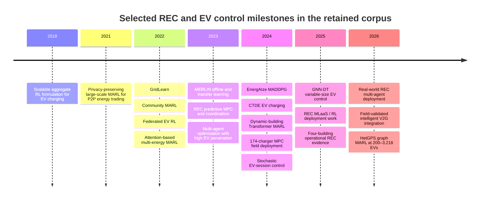
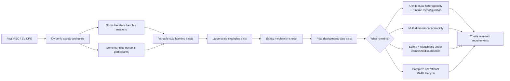

# Deep Research B — Control and Learning in Renewable Energy Communities and EV Charging

## Executive summary

This scoping review examined **control and learning approaches for Renewable Energy Communities (RECs), grid-interactive communities, multi-energy communities, and electric-vehicle charging**, with particular attention to the distinctions that matter for the thesis: heterogeneity, dynamic availability, variable populations, scalability, decentralization, safety, and real-world operation.

The curated core corpus contains **23 primary studies published or released between 2018 and 12 August 2026**. It deliberately includes not only MARL, but also single-agent RL, federated RL, optimization, MPC, stochastic programming, and non-learning multi-agent systems. That comparison is essential because several problems sometimes presented as motivations for MARL can already be handled effectively by simpler approaches. For example, a deployed MPC system controlled **174 EV chargers for three weeks and reported a 59% average daily grid-peak reduction**, showing that large-scale, dynamically occupied EV charging infrastructure does not intrinsically require MARL. citeturn20search0

The most important finding for the thesis is the distinction between **dynamic assets and dynamic agents**. EV arrival and departure are routinely represented in the literature, but usually inside a fixed control architecture: a charger remains controller \(i\), while the EV connected to it appears or disappears; an EV agent remains part of a fixed index set while its availability changes; or an environment is rebuilt with a different number of chargers between experiments. Puech et al., for example, model session starts, ends, energy requests and early disconnections over 32 fixed charging slots; Hermans et al. forecast charger occupancy over 174 fixed chargers. Neither implies that controller objects with new observation/action interfaces can be created online. citeturn18search3turn20search0

There is, however, an important counterexample to any claim that **dynamic participation has not been studied in energy MARL**. Wu et al. explicitly address multi-energy buildings that dynamically join or depart from a virtual power plant and introduce a Multi-Agent Transformer with an adaptation module; their experiments vary between three and nine buildings and include different building types and regions. citeturn14search0turn14search25 This means the thesis should **not** claim that variable multi-agent participation is absent from the literature.

Recent methods also weaken broad claims about scalability. GNN-DT handles changing problem sizes and is evaluated up to 250 chargers; a model trained on 25 chargers is directly evaluated on configurations with 5, 50, 75 and 100 chargers. citeturn17search3 HetGPS, a very recent **August 2026 preprint**, uses parameter-shared graph MARL across 200–3,218 EVs, maintains a constant learned model size across those fleet sizes, and demonstrates zero-shot transfer to larger distribution networks. citeturn23view1

Likewise, it would be incorrect to claim that **real-world intelligent energy control is absent**. Beyond the 174-charger MPC deployment, Wang et al. report field validation of bidirectional charging at Ostra Sport Park in Dresden using OCPP, vehicle SoC acquisition, user preferences and a real-time optimizer. citeturn22search5 In RECs, Patrício et al. report a peer-reviewed real-world multi-agent-system deployment, while Gonçalves et al. describe an RL-based MLaaS framework for REC operation. citeturn22search3turn22search2 Fonseca et al. additionally report preliminary evidence from an operational four-building REC, including approximately 9% lower daily peak demand and 5% lower energy cost. citeturn21search8

The residual gap is therefore narrower and stronger:

> **The literature contains solutions for dynamic EV sessions, variable problem sizes, dynamic building participation, large-scale coordination, constrained control and real-world deployment individually. What remains poorly demonstrated is their integration: heterogeneous controllers and assets that can be reconfigured during operation, at increasing scale, while retaining acceptable learning/control performance, communication and computational cost, physical safety, and a deployable lifecycle.**

The evidence supports a **strong** gap for genuinely open heterogeneous agent populations, a **moderate** gap for multi-dimensional scalability, a **moderate** gap for jointly safe and robust operation, and a **strong** gap for replicated, long-duration operational MARL across heterogeneous REC/EV systems. These classifications deliberately account for the counterexamples rather than ignoring them.

The complete CSV-ready extraction with one row per retained primary study is available here:

[Download the full Deep Research B evidence matrix](sandbox:/mnt/data/DeepResearch_B_REC_EV_Evidence_Matrix.csv)

## Scoping-review protocol and corpus

### Review questions

The review was structured around six questions rather than around a predetermined conclusion:

**Control question.** Which control and learning families are actually used in REC and EV energy management, and what problem characteristics motivate optimization, MPC, RL or MARL?

**Heterogeneity question.** What is heterogeneous in each study: demand profiles, assets, local objectives, observation spaces, action spaces, physical capabilities, communication interfaces, or the agents themselves?

**Dynamics question.** When a paper refers to EV arrivals, changing resources, dynamic participation, or variable numbers of agents, what actually changes during execution?

**Scalability question.** Which dimensions of scale are evaluated: number of EVs, buildings or agents; neural-network size; observation/action dimensions; communication; training effort; inference time; network size; or physical deployment scale?

**Safety and robustness question.** How are physical constraints, uncertainty, early EV departure, grid voltage, user requirements, faults and distribution shift handled?

**Deployment question.** Is the evidence purely simulated, based on real data, based on a digital twin, validated in a physical testbed, or integrated into an operational system?

These distinctions are necessary because the literature contains examples where the same term can hide substantially different evidence. A simulation using real smart-meter data is still a simulation; a changing charging session does not necessarily change the agent population; and testing the same neural network on 100 instead of 25 nodes is not equivalent to dynamically introducing a previously unseen controller interface during an ongoing episode. MERLIN, for instance, uses a digital twin of a real 17-building residential community and real smart-meter data, but its evaluation remains a digital-twin evaluation. citeturn21search0

### Search strategy

The search was conducted on **12 August 2026** without institutional database access. Primary records were searched through IEEE Xplore, ScienceDirect/Elsevier, MDPI, arXiv and university/research-institution repositories. Citation chaining from relevant primary papers was also used to discover older and related work.

The search families were variations of:

```text
("renewable energy community" OR "local energy community"
 OR "smart community" OR "grid-interactive community")
AND
("reinforcement learning" OR "multi-agent reinforcement learning"
 OR MARL OR "model predictive control" OR MPC
 OR optimization OR "multi-agent system")
```

```text
("electric vehicle" OR EV OR V2G)
AND
(charging OR "energy management")
AND
("multi-agent reinforcement learning" OR
 "federated reinforcement learning" OR
 "reinforcement learning" OR
 "model predictive control" OR
 "stochastic programming")
```

A second search layer explicitly targeted dynamics and scale:

```text
("arrival" OR "departure" OR "dynamic participation"
 OR "join" OR "leave" OR "variable number"
 OR "dynamic state-action space" OR "early disconnection"
 OR "open population")
AND
(EV OR building OR energy OR REC OR VPP)
```

A third targeted operational evidence:

```text
(deployment OR "implementation study" OR field
 OR operational OR testbed OR "real-world")
AND
(EV charging OR V2G OR REC OR "energy community")
AND
(control OR reinforcement learning OR multi-agent)
```

The principal review window was **2018–2026**, selected to capture the current deep-RL/MARL period while retaining Sadeghianpourhamami et al.'s early scalable model-free EV-coordination formulation as a useful baseline. Their method uses fitted Q-iteration with a state representation designed to be independent of the number of charging stations and explicitly tests generalization to larger station sets using simulations based on real EV-charging data. citeturn17search0turn17search10

### Inclusion and exclusion

A study was retained when it presented original experimental evidence for an operational control or scheduling method in a REC, local/smart/grid-interactive community, multi-energy aggregation or EV-charging/V2G setting; contained sufficient methodological information to classify the controller; and was available from a primary publisher, author repository or original preprint.

Surveys, reviews, editorials, pure forecasting studies, planning/sizing studies without operational control, and papers without original evaluation were excluded from the core matrix. Where a peer-reviewed version and preprint represented the same work, they were treated as one study. Recent preprints were retained only when materially relevant and are explicitly labelled as non-peer-reviewed.

The corpus contains Portuguese research contributions, particularly Fonseca et al., Faia et al., Gonçalves et al. and Patrício et al. citeturn16search1turn16search2turn22search2turn22search3 No Portuguese-language paper was added merely to satisfy a language quota; relevance and primary-source quality remained the inclusion criteria.

### Selection limitations

This is a **curated scoping review**, not a PRISMA-compliant exhaustive systematic review. No authenticated Scopus or Web of Science access was available. Public search interfaces also do not expose stable, reproducible complete result counts, so it would be misleading to invent numbers for “records identified”, “records screened” or database-specific coverage.

The final 23-study corpus was iteratively deduplicated and selected for **coverage of mechanisms and evidence types**, rather than for bibliometric completeness. Consequently, absence from this corpus must not be interpreted as proof that no such paper exists.

A later thesis-quality validation should rerun the final search strings through FEUP's institutional Scopus/Web of Science access and document the number of records, deduplication and screening decisions. Until that step is completed, claims such as “no previous study” should be avoided.

### Operational classification used in the matrix

The review uses a deliberately strict vocabulary:

| Classification | Meaning |
|---|---|
| **Session-level dynamics** | EVs plug in, disconnect or change charging state, while charger/controller identities remain fixed. |
| **Asset availability** | An asset becomes usable/unusable inside a fixed agent or controller. |
| **Variable instance size** | An algorithm is evaluated with different \(N\) between experiments. |
| **Dynamic participation** | A participant/controller can join or leave the coordinated system during the modeled process. |
| **Agent loss** | An existing controller becomes unavailable during operation. |
| **True open population** | Controllers can be instantiated/removed online, potentially with different capabilities/interfaces, without redesigning the global architecture or retraining for that precise composition. |

The final category is intentionally demanding. None of the retained REC/EV papers demonstrates the full version of it. Wu et al. are the closest explicit energy-domain counterexample because buildings can dynamically join and depart, but the method still works within a predefined family of building representations and a relatively small simulated range of three to nine buildings. citeturn14search0

## Evidence matrix

The following is the compact human-readable version. The downloadable CSV contains the full fields requested: problem, method, heterogeneity, dynamic type, scale, evaluation setting, metrics, findings, artifacts and limitations.

| Study | Approach and problem | Dynamics and heterogeneity | Scale and evidence | Key implication |
|---|---|---|---|---|
| **Sadeghianpourhamami et al.** | Fitted Q-iteration for joint EV charging | Dynamic EV sessions; aggregate representation independent of \(N\) | Real-data simulation; generalization to larger station sets | Variable EV availability and scale do **not** inherently require MARL. citeturn17search0 |
| **Ye et al.** | Privacy-preserving scalable multi-agent DRL for P2P energy trading | Multiple private prosumers; fixed participant model | Large-scale simulation | Counterexample to “decentralized MARL cannot scale while preserving private information.” citeturn15search0 |
| **Pigott et al., GridLearn** | Grid-aware building MARL | Loads, storage and inverters inside a predefined schema | IEEE 33-bus simulation | Over-voltage events reduced by 34%; demonstrates simultaneous local/grid objectives. citeturn21search1 |
| **Lai et al.** | MARL community energy management under renewable uncertainty | Multiple community participants; fixed architecture | Community simulation | MARL-based community coordination under uncertainty is already established literature. citeturn16search3turn16search7 |
| **Nagpal et al.** | Hierarchical shared-storage/community management | Local participants plus community storage | Numerical study | Hierarchical optimization is a credible alternative to MARL for decomposing local/community decisions. citeturn9search9 |
| **Zhu et al.** | CTDE, SAC, counterfactual baseline, attention, Lagrangian reward | Heterogeneous multi-energy resources; fixed agents | Simulation based on actual data | Attention addresses growing joint information; Lagrangian reward addresses storage constraints. citeturn20academia14 |
| **Chu et al.** | Multi-agent federated RL for residential EV fleets | Local EV data retained; compatible clients | Simulation | Federated learning offers a decentralization/privacy mechanism without raw-experience centralization. citeturn18search1 |
| **Fonseca et al. 2022** | FlexOffer-based scheduling | Different flexible-load types and time windows | REC simulation | Heterogeneous flexibility can be normalized through explicit common abstractions without RL. citeturn16search2 |
| **Nweye et al., MERLIN** | Independent offline RL and transfer learning | 17 buildings with unique occupant behavior | Real-community digital twin in CityLearn | Transfer across buildings can retain comparable performance while reducing training effort. citeturn21search0 |
| **Srithapon & Månsson** | HEMS MPC + community AC-OPF coordination | EVs, heat pumps, thermal storage and grid constraints | Co-simulation | Predictive optimization jointly handles heterogeneous assets and physical network constraints without MARL. citeturn16search0 |
| **Faia et al.** | Optimization-based multi-agent EMS with coordinator | Community resources and high EV penetration | Numerical study | A multi-agent architecture can reduce central optimization burden without learning-based agents. citeturn16search1 |
| **Wu et al.** | Multi-Agent Transformer + AdaptMLP | **Buildings dynamically join/depart**; different types/regions | 3–9 buildings, IEEE 33-bus simulation | Important direct counterexample to “dynamic participating energy agents have not been studied.” citeturn14search0 |
| **Fonseca et al., EnergAIze** | MADDPG for V2G/REC energy management | Different dwelling asset sets and selectable user objectives; fixed dwelling agents | 9-dwelling CityLearn simulation | Demonstrates heterogeneous assets and personalized/local objectives combined with community optimization. citeturn21search5 |
| **Wilk et al.** | Smart-community MARL | Community energy agents/resources | Simulation | Additional evidence that MARL community control is not an isolated formulation. citeturn15search3 |
| **Shojaeighadikolaei et al.** | CTDE-DDPG vs independent DDPG | Stochastic EV arrival/departure within compatible EV-agent architecture | Up to 20 agents, simulation | CTDE reportedly reduces total variation by about 36% and average charging cost by about 9.1% in the paper's comparisons. citeturn18search0turn18search8 |
| **Puech et al.** | MPC and two-stage stochastic programming | Start/end uncertainty and early disconnections over fixed slots | 32 slots; 22-day real dataset; simulation | Explicitly handles uncertain departures without MARL; two-stage optimization improves robustness to early disconnects. citeturn18search3turn18search13 |
| **Hermans et al.** | MPC/QP with occupancy and PV forecasting | Changing sessions over fixed chargers | **174 chargers; three-week operational deployment** | Average daily grid peak reduced by 59%. A major non-RL operational counterexample. citeturn20search0 |
| **Orfanoudakis et al., GNN-DT** | Offline Decision Transformer + GNN | Variable graph/problem dimensions | Tests 5–100 chargers; additional 250-charger case | Graph embeddings allow one model architecture to work across changing problem sizes. citeturn17search3 |
| **Gonçalves et al.** | Multi-tenant RL / MLaaS for REC management | Multiple tenants | Documented deployed framework | Prevents an absolute “RL has never been deployed in RECs” claim; exact closed-loop extent should still be audited from the full paper. citeturn22search2 |
| **Fonseca et al. 2025** | EnergAIze/MADDPG embedded in a real-world REC data/integration framework | Four heterogeneous residential buildings; incomplete/noisy real data | Operational four-building REC; preliminary evidence | Reports roughly 9% lower daily peak demand and 5% lower energy cost. citeturn21search8turn23view2 |
| **Patrício et al.** | Real-world REC multi-agent system | Community configuration, storage and participants | Peer-reviewed real-world deployment | Strong counterexample to the claim that multi-agent REC energy management has never reached real operation; it is not, by itself, evidence of MARL deployment. citeturn22search3turn22search13 |
| **Wang et al., bidirectional charging** | Central optimizer + OBD-II + OCPP + 5G | EV sessions, user preferences and heterogeneous communication components | Field validation at Ostra Sport Park | Shows practical real-time V2G integration and standard-protocol deployment without MARL. citeturn22search5 |
| **Wang et al., HetGPS** | Parameter-shared heterogeneous-graph SAC + learned risk + physics runtime filter | Three EV types; session arrivals/departures within fixed agent index set | **200–3,218 EVs**, simulation; Aug. 2026 preprint | Constant learned parameter count, topology transfer and explicit runtime safety protection; not yet peer-reviewed and not physically deployed. citeturn23view1 |

Several rows deserve special caution when they are later converted into thesis prose. In HetGPS, for example, the exogenous process explicitly contains EV arrival/departure events, but the formal Dec-POMDP still defines a fixed agent set \(\mathcal{I}=\{1,\ldots,N\}\). citeturn23view1 Therefore it is evidence for **dynamic EV availability inside a scalable heterogeneous graph controller**, not evidence for arbitrary online creation and removal of controller identities.

Likewise, GNN-DT demonstrates **size generalization** rather than an open population: a model trained on one charger count can be evaluated on other counts because the GNN representation is size/permutation compatible. citeturn17search3 This distinction should be maintained consistently in Chapter 2.

## Taxonomy of approaches and mechanisms

The literature is better understood as a set of architectural mechanisms than as a simple “optimization versus MARL” progression. Several mechanisms solve different parts of the real-world problem and can be combined.

The following taxonomy is derived from the retained primary studies. Representative model-based approaches include predictive control for heterogeneous REC assets and deployed EV infrastructure, while learning-based approaches span CTDE, federated learning, attention/Transformers, graph representations, offline transfer and physics-based runtime protection. citeturn16search0turn18search1turn20academia14turn17search3turn23view1

```mermaid
flowchart TD
    A[REC and EV control] --> B[Model-based control]
    A --> C[Learning-based control]
    A --> D[Population and availability representation]
    A --> E[Operational protection and deployment]

    B --> B1[Central or distributed optimisation]
    B --> B2[Model Predictive Control]
    B --> B3[Stochastic programming]
    B --> B4[Hierarchical coordination]

    C --> C1[Aggregate / single-agent RL]
    C --> C2[Independent RL]
    C --> C3[CTDE MARL]
    C --> C4[Federated RL]
    C --> C5[Attention / Transformers]
    C --> C6[Graph-based policies]
    C --> C7[Offline and transfer learning]

    D --> D1[Fixed charger + dynamic session]
    D --> D2[Fixed agent + dynamic asset availability]
    D --> D3[Parameter sharing]
    D --> D4[Graph / set representations]
    D --> D5[Adapters for dynamic participants]
    D --> D6[True open population: weak evidence]

    E --> E1[Reward / constraint penalties]
    E --> E2[Physics or optimisation projection]
    E --> E3[Runtime safety filters]
    E --> E4[Forecasting and uncertainty models]
    E --> E5[OCPP / APIs / edge integration]
```



### Fixed controllers with dynamic session state

This is the dominant mechanism in EV charging.

The architecture allocates a stable slot/controller representation, while variables such as:

- occupancy;
- arrival time;
- expected departure;
- requested energy;
- current SoC;
- connection state

change over time.

Puech et al. make this distinction especially explicit: they use 32 fixed slots and stochastic variables describing session start, end, requested energy and announced parking time. citeturn18search13 Hermans et al. similarly operate 174 fixed chargers while forecasting charger occupancy. citeturn20search0

**Strength:** simple fixed-dimensional interfaces and straightforward integration with physical chargers.

**Weakness:** dynamic users are not dynamic control agents.

**Typical assumption:** maximum charger/controller topology is known beforehand.

### Aggregate, size-independent representations

Sadeghianpourhamami et al. avoid an observation vector that grows directly with the number of charging stations and show generalization to larger station sets. citeturn17search0

**Strength:** avoids direct network-size dependence and can make centralized RL computationally attractive.

**Weakness:** aggregation can remove information required for individual objectives or physical/network coupling.

**Typical assumption:** individual heterogeneity can be compressed into statistics sufficient for the control objective.

### CTDE

CTDE separates information available during training from information needed at runtime. Shojaeighadikolaei et al. use a centralized critic during training and decentralized EV decisions during execution; EnergAIze similarly builds on MADDPG for decentralized local decisions. citeturn18search0turn21search5

**Strength:** enables coordination during training while retaining decentralized execution and, potentially, greater data locality.

**Weakness:** centralized training can itself become a scale bottleneck as the joint state/action space grows.

**Typical assumption:** agents have sufficiently compatible interfaces for the centralized learning structure.

### Federated learning

Chu et al. use federated reinforcement learning for EV-fleet charging, providing a different response to decentralization and privacy. citeturn18search1

**Strength:** raw experiences can remain local.

**Weakness:** federated parameter aggregation does not automatically solve policy heterogeneity; incompatible state/action structures remain difficult.

**Typical assumption:** participating clients use compatible models and an agreed aggregation protocol.

### Attention and Transformers

Zhu et al. explicitly introduce attention because increasing agent count increases the joint observation burden. citeturn20academia14 Wu et al. go further by using a Multi-Agent Transformer and an AdaptMLP module to adapt to dynamically participating multi-energy buildings. citeturn14search0

**Strength:** variable sets of relevant entities can be weighted without naïvely concatenating all information.

**Weakness:** attention accepts variable cardinality more naturally than a fixed MLP, but the semantic structure of each token usually remains predetermined.

**Typical assumption:** a new participant can be encoded into the same feature/token vocabulary.

### Graph representations and parameter sharing

GNN-DT uses graph embeddings to make the policy representation compatible with different charger counts and shows generalization across problem sizes. citeturn17search3 HetGPS uses shared graph-policy parameters and heterogeneous node types; its learned policy/risk-model parameter count remains **383,702 from 200 through 3,218 EVs**, while computation and topology buffers still grow with the graph. citeturn23view1

This is an important distinction for the thesis:

> **Constant neural-network parameter count is one form of scalability; it does not imply constant computation, communication, memory, training cost or wall-clock latency.**

HetGPS itself acknowledges that node-wise computation and non-learned topology buffers continue to grow with system size. citeturn23view1

**Strength:** natural variable-size topology representation and reusable local parameters.

**Weakness:** a new node still needs a known node type, known feature semantics and a compatible action interface.

**Typical assumption:** relationships can be expressed by a graph schema known at design time.

### Offline and transfer learning

MERLIN transfers policies between different buildings and explores limited training data. citeturn21search0 GNN-DT learns from pre-collected trajectories rather than relying entirely on online interaction. citeturn17search1 HetGPS evaluates zero-shot topology transfer. citeturn23view1

**Strength:** addresses costly or unsafe online exploration and reduces retraining burden.

**Weakness:** transfer usually assumes source and target systems remain semantically compatible.

**Typical assumption:** observations/actions or graph node types can be mapped consistently between source and target.

### Hierarchical control

Nagpal et al. and Srithapon and Månsson illustrate a broader architectural principle: local controllers can optimize participant-level resources while a higher-level controller coordinates community or grid objectives. citeturn9search9turn16search0

**Strength:** naturally separates timescales, responsibilities and local/community objectives.

**Weakness:** coordination quality depends on what information is exchanged between levels.

**Typical assumption:** the hierarchy and responsibilities are known a priori.

This remains highly relevant even where the lower-level controller becomes RL or MARL.

### Constraint penalties and runtime protection

Zhu et al. use a Lagrangian reward to incorporate storage-capacity constraints. citeturn20academia14 HetGPS introduces a stronger distinction between **learning what action is useful** and **deciding whether the action can safely be applied**: the learned policy proposes charging actions, a graph model estimates risk, and a physics-based projection modifies actions when voltage safety requires it. citeturn23view1

The latter is particularly relevant to RQ3 because it shows that safe MARL need not rely solely on reward penalties.

HetGPS also provides an important caution: the authors explicitly state that their evidence remains empirical and that certified deployment would require validated model-error margins. citeturn23view1

### Mechanisms that were not strongly represented

Some mechanisms requested in the search protocol were **not prominent enough in the retained REC/EV primary corpus to justify presenting them as established REC/EV solutions**:

| Mechanism | Finding in this corpus |
|---|---|
| Padding/dummy agents | Common conceptually in MARL, but not a dominant mechanism in the retained REC/EV studies. |
| Consensus-based variable-team control | Important in distributed control more generally, but not central in the retained REC/EV learning corpus. |
| Explicit role-based MARL | No strong REC/EV representative retained. |
| Meta-learning for online population changes | No sufficiently strong primary REC/EV example retained. |
| Curriculum over population composition | No sufficiently strong primary REC/EV example retained. |
| Generic action masking as the main population mechanism | Not dominant; physics/constraint projection is more clearly documented in the retained recent EV safety work. |
| Fully modular policies with arbitrary new observation/action schemas | No convincing operational REC/EV example retained. |

Absence from this **curated corpus** is not proof of absence from the entire literature. These categories should therefore be used as follow-up search targets if they become central to a thesis claim.

### Development over time

The retained studies show a progression from scalable aggregate RL, through MARL/privacy/hierarchical architectures, towards transfer, dynamic participation, graph representations and deployment-oriented safety. Representative milestones are supported by Sadeghianpourhamami et al., GridLearn, MERLIN, Wu et al., Hermans et al., GNN-DT and HetGPS. citeturn17search0turn21search1turn21search0turn14search0turn20search0turn17search3turn23view1



## Counterexamples to overly broad gap claims

The review substantially changes how several gaps should be phrased in Chapter 2.

### “Dynamic agent participation has not been studied in energy MARL”

**Rejected.**

Wu et al. explicitly formulate buildings that dynamically join or depart a multi-building multi-energy VPP. Their MAT-Adapt architecture uses a Multi-Agent Transformer plus adaptation modules and evaluates dynamic participation across different building types and regions. citeturn14search0

A defensible statement is instead:

> **Dynamic participation has been studied, but evidence remains concentrated in simulated settings with predefined participant types, interfaces and relatively bounded composition changes.**

### “EV arrival and departure demonstrate open-population MARL”

**Rejected.**

Arrival/departure frequently changes a **session state**, not the population of controller architectures. Puech et al. retain 32 slots while sessions begin and end; Hermans et al. retain 174 chargers while occupancy changes. citeturn18search13turn20search0

Even HetGPS includes EV arrival/departure events in its exogenous process while formally retaining the fixed agent set \(\mathcal{I}=\{1,\dots,N\}\). citeturn23view1

Thus:

```text
EV leaves charger
        ≠
controller disappears
        ≠
new controller type can appear
```

### “MARL is required to cope with dynamic EV sessions”

**Rejected.**

Puech et al. handle uncertain session starts, ends, energy requests and early disconnections using MPC and stochastic programming. citeturn18search3 Hermans et al. operationally coordinate 174 chargers with MPC and occupancy forecasts. citeturn20search0

MARL therefore needs to be justified by factors such as decentralization, private/local objectives, adaptation, high-dimensional interactions or model uncertainty—not merely by the existence of EV arrivals and departures.

### “RL/MARL cannot scale to large EV populations”

**Rejected as an absolute statement.**

Sadeghianpourhamami et al. design a representation independent of station count and evaluate generalization to larger charging sets. citeturn17search0 GNN-DT studies up to 250 chargers. citeturn17search3 The HetGPS preprint evaluates 200–3,218 EVs with shared graph parameters and zero-shot topology transfer. citeturn23view1

The defensible gap is **multi-dimensional scalability**, not basic population scalability.

### “Energy MARL assumes homogeneous agents”

**Too broad.**

EnergAIze models dwellings with different combinations of assets and allows prosumers to select different individual management objectives. citeturn21search5 MERLIN explicitly works with unique occupant behavior across 17 buildings. citeturn21search0 Wu et al. evaluate different building types and regions, while HetGPS uses three EV battery/power configurations and a heterogeneous bus-agent graph. citeturn14search0turn23view1

But these examples reveal a useful distinction:

> **Environmental and asset heterogeneity is increasingly represented; arbitrary architectural heterogeneity in observation spaces, action spaces, capabilities and runtime interfaces remains much less demonstrated.**

### “No real-world intelligent REC/EV control exists”

**Rejected.**

Hermans et al. integrated MPC into a real corporate microgrid controlling 174 chargers for three weeks. citeturn20search0 Wang et al. report field validation of bidirectional EV charging with OCPP and 5G-connected data exchange. citeturn22search5 Patrício et al. report real-world deployment of an REC multi-agent system. citeturn22search3 Gonçalves et al. report an RL-based REC MLaaS framework, and Fonseca et al. provide preliminary evidence from an operational four-building REC. citeturn22search2turn21search8

The narrower claim is:

> **Operational evidence exists, but robust, replicated and long-duration MARL evidence remains much thinner than simulation evidence.**

### “Safety in MARL is only encoded in the reward”

**Rejected.**

Zhu et al. do use a Lagrangian reward for storage constraints, demonstrating the training-time approach. citeturn20academia14 HetGPS instead places a physics-anchored projection layer between the learned action and grid actuation, explicitly separating task policy from runtime safety intervention. citeturn23view1

Again, the residual gap is not existence but **generality, guarantees and operational validation**.

## Gap assessment for the thesis

The following classifications refer specifically to the evidence in this review. “Strong” does not mean “nobody has studied the topic”; it means that the **residual problem relevant to the thesis remains poorly covered even after considering the strongest counterexamples**.

### Strong — open heterogeneous agent populations in operational energy systems

A number of works address adjacent problems:

- EV sessions appear and disappear at fixed charger/control slots; citeturn18search3turn20search0
- algorithms generalize across different fleet sizes; citeturn17search3
- buildings dynamically join and leave a VPP; citeturn14search0
- graph policies handle heterogeneous EV types and thousands of agents. citeturn23view1

However, the retained corpus does not demonstrate a mature operational setting in which agents with **different capabilities, observation/action interfaces and control roles can be instantiated or removed online without redesigning or retraining the overall controller architecture**.

**Classification: STRONG.**

A defensible gap statement is:

> **Existing REC and EV control research increasingly accommodates dynamic availability, variable problem sizes and, in some cases, dynamic participant composition. Nevertheless, evidence remains limited for operational multi-agent control architectures that simultaneously support runtime population changes and architectural heterogeneity across agent capabilities, observation/action interfaces and asset types.**

This is much stronger than saying “dynamic populations have not been studied”.

### Moderate — multi-dimensional scalability

Population scale by itself is increasingly well covered.

Sadeghianpourhamami et al. remove direct dependence of the state representation on charger count; GNN-DT evaluates 250 chargers; and HetGPS reaches 3,218 EVs while retaining a fixed learned parameter count. citeturn17search0turn17search3turn23view1 Ye et al. additionally provide primary evidence for large-scale privacy-preserving multi-agent energy trading. citeturn15search0

The residual question is what happens when several dimensions increase **together**:

\[
N \uparrow,\quad
\text{heterogeneity} \uparrow,\quad
\text{reconfiguration} \uparrow,\quad
\text{environment complexity} \uparrow
\]

while simultaneously constraining:

\[
\text{training time},\;
\text{memory},\;
\text{communication},\;
\text{inference latency},\;
\text{energy/resource consumption}.
\]

HetGPS is a particularly strong counterexample because it explicitly studies model parameter count and topology scale, but it also states that graph computation and non-learned topology data continue to grow with system size. citeturn23view1

**Classification: MODERATE.**

Recommended gap statement:

> **Scalable REC and EV control has been demonstrated along individual dimensions, including fleet size, policy parameter sharing and topology transfer. Evidence is less complete regarding multi-dimensional scalability when population size, heterogeneity, reconfiguration, communication demand and computational constraints increase jointly.**

This directly supports the revised RQ2.

### Moderate — safe and robust operation under combined uncertainty

There is already meaningful work on constraints and uncertainty:

- stochastic programming for uncertain EV departures and demand; citeturn18search3
- MPC with real occupancy/PV forecasting in a deployed site; citeturn20search0
- Lagrangian constraint integration in MARL; citeturn20academia14
- runtime physics-based intervention in HetGPS. citeturn23view1

Therefore the literature cannot be characterized as ignoring safety or robustness.

What is still weak is combined evidence across:

```text
forecast error
+ missing/noisy measurements
+ unexpected user behaviour
+ EV disconnection
+ communication failure
+ population reconfiguration
+ hard network constraints
+ distribution shift
```

especially in operational MARL.

Fonseca et al.'s real-world REC study is particularly useful because it reports practical problems such as incomplete/noisy data, heterogeneous subsystem integration, synchronization issues and missing EV SoC—problems that are largely absent from clean simulation benchmarks. citeturn21search8turn21search11

**Classification: MODERATE.**

### Strong — replicated operational MARL evidence

The important nuance is:

> **Deployment is not absent.**

There are real deployments of model-based EV control, V2G infrastructure, REC multi-agent systems and RL-related REC frameworks. citeturn20search0turn22search5turn22search3turn22search2

But the corpus still contains far more MARL evidence in simulation than evidence of:

- long-duration MARL inference;
- multiple heterogeneous physical sites;
- edge policy rollout and update;
- monitoring and rollback;
- policy/version traceability;
- communication interruption;
- device failure;
- online population change;
- operational safety intervention;
- maintenance across controller versions.

EnergAIze's 2024 paper, for example, describes the decentralized edge architecture but evaluates the control strategy in CityLearn rather than demonstrating the complete edge deployment at that stage. citeturn21search2turn21search5 The 2025 follow-up moves much closer to real operation, but presents preliminary evidence from four buildings rather than a large replicated deployment study. citeturn21search8

**Classification: STRONG**, when carefully formulated as:

> **Although operational intelligent-control and multi-agent deployments exist in REC and EV settings, replicated evidence for the complete MARL policy lifecycle—from training and validation to heterogeneous distributed execution, monitoring, updating and recovery—remains limited.**

That formulation will connect Chapter 2 naturally to Chapter 7.

### Moderate — comparison with strong non-learning baselines

The corpus shows that classical approaches remain highly competitive in exactly the real-world settings that MARL ultimately wants to reach.

Srithapon and Månsson coordinate EVs, heat pumps, thermal storage and network constraints through MPC and OPF. citeturn16search0 Puech et al. explicitly model uncertain EV behavior through stochastic programming. citeturn18search3 Hermans et al. provide perhaps the strongest practical counterpoint: a relatively conventional MPC formulation was actually deployed on 174 chargers and achieved substantial peak reduction. citeturn20search0

This means future MARL experiments should not establish value merely by beating an uncontrolled or simple RBC baseline.

**Classification: MODERATE.**

A useful thesis implication is:

> For claims about the **need for MARL**, comparisons should include an appropriate optimization/MPC baseline whenever the required model and computational conditions make such a baseline feasible.

The thesis can then explain where MARL provides additional value: model-free adaptation, local autonomy, privacy, decentralized decision-making, heterogeneous objectives, transfer or reduced online optimization overhead.

### Tentative — personalized mixed objectives as a residual gap

Personalization is not absent. EnergAIze explicitly allows individual prosumers to select different management objectives while still contributing to REC-wide performance. citeturn21search5 Other work separates participant-level and community-level objectives through hierarchy or markets. citeturn16search0turn16search1

The corpus does not support a strong claim that personalized or conflicting objectives are generally neglected.

**Classification: TENTATIVE.**

This is better treated as an important **problem characteristic** of the thesis than as one of its strongest literature gaps.

### Tentative — reproducibility as an independent gap

Some work provides open environments, detailed preprints and reproducibility information. GridLearn is openly described as a research platform; MERLIN builds on CityLearn; GNN-DT provides detailed appendices; HetGPS contains an explicit reproducibility section. citeturn21search1turn21search0turn17search3turn23view1

Other retained studies do not expose obvious code/data artifacts in the primary records inspected.

Because artifact availability was not exhaustively verified at repository level for every paper, a broad “the field is not reproducible” statement would currently be too strong.

**Classification: TENTATIVE.**

### Synthesized gap map

| Candidate gap | Rating | Strongest counterexample | What remains |
|---|---|---|---|
| Dynamic energy participants have never been studied | **Rejected** | Wu et al.: buildings join/depart | Open, heterogeneous interfaces at runtime |
| True open heterogeneous agent population | **Strong** | Wu + HetGPS come closest from different directions | Runtime join/leave + new capabilities/interfaces + operational evidence |
| Population scalability | **Rejected as absolute** | GNN-DT; HetGPS | Joint scaling across multiple dimensions |
| Multi-dimensional scalability | **Moderate** | HetGPS | Compute + communication + heterogeneity + reconfiguration together |
| Safety/robustness absent | **Rejected** | Puech; HetGPS | Combined disturbances and operational guarantees |
| Operational intelligent control absent | **Rejected** | Hermans; Wang; Patrício | MARL-specific replicated operational lifecycle |
| Operational MARL lifecycle | **Strong** | REC RL deployments/pilots prevent an absolute claim | Long-duration multi-site train→deploy→monitor→update evidence |
| Personalized objectives absent | **Tentative / weak** | EnergAIze | Broader validation, not basic existence |
| Poor reproducibility | **Tentative** | GridLearn/CityLearn/GNN-DT/HetGPS artifacts | Corpus-level quantitative audit needed |

The resulting thesis logic should therefore be:



This is a considerably stronger research position than constructing Chapter 2 around the claim that previous work simply does not exist.

## Recommended next steps and next Deep Research

The immediate thesis action should be to use this corpus to revise the energy-specific parts of Chapter 2 in three ways.

First, **Section 2.4 on Renewable Energy Communities** can now distinguish three layers of heterogeneity: heterogeneous energy assets; heterogeneous participants/objectives; and heterogeneous agent/controller interfaces. The first two are well represented in the literature, including EnergAIze, MERLIN, Srithapon and Wu et al.; the third is where the residual research problem becomes substantially stronger. citeturn21search5turn21search0turn16search0turn14search0

Second, **Section 2.5 on control and learning approaches** should not be organized as a story in which optimization is old and MARL is simply better. The evidence supports a more nuanced progression:

```text
RBC
  ↓
explicit optimization
  ↓
MPC / stochastic control
  ↓
aggregate or single-agent RL
  ↓
independent RL
  ↓
MARL / CTDE / federated RL
  ↓
attention and graph MARL
  ↓
hybrid learned + model-based safety/deployment
```

Each step trades modelling effort, computation, adaptability, decentralization and operational assurance differently. The deployed 174-charger MPC system is an especially important counterexample that should stop the thesis from overselling MARL. citeturn20search0

Third, **Section 2.7 should retain the revised RQ2 formulation**. The B review strengthens the decision already made after Deep Research A: scalability must be multi-dimensional. The literature contains convincing large-\(N\) results, particularly GNN-DT and the very recent HetGPS preprint, so population count alone is no longer a defensible gap. citeturn17search3turn23view1

The most productive next investigation is therefore **Deep Research C — Simulation and Benchmarking Environments for REC, EV, and Real-World MARL**. CityLearn and GridLearn already play important roles in the retained studies, while recent work extends these environments toward EVs and more realistic grid interaction. citeturn21search1turn21search12turn21search14 The next review should determine exactly what existing simulators can and cannot represent before Chapter 2 makes claims about the contribution of the thesis simulator.

### Prompt for the next Deep Research

> **Deep Research C — Simulation and Benchmarking for MARL in Renewable Energy Communities and EV Charging. Conduct a transparent scoping review of primary sources describing simulation, co-simulation, digital-twin and benchmark environments used for RL/MARL in energy communities, grid-interactive buildings, EV charging, V2G and related distributed energy systems. Prioritize CityLearn and its versions/challenges, EVLearn, GridLearn, PowerGridworld and comparable primary platforms. For each environment record: supported assets; EV model; V2G; arrival/departure and mobility modeling; heterogeneous agent types; variable agent populations; whether agents can join/leave during an episode; observation/action extensibility; grid/power-flow modeling; communication/network modeling; safety constraints; scenario generation; real-world data support; APIs and RL/MARL compatibility; scalability evidence; parallelization/performance; reproducibility; code/license; and known limitations. Explicitly distinguish dynamic asset state from dynamic agent populations. Build a one-row-per-environment evidence matrix, taxonomy, counterexamples to proposed simulator gaps, and residual gap statements rated strong/moderate/tentative. Compare existing capabilities directly against the requirements of a simulator for dynamically reconfigurable, heterogeneous, real-world CPS. Do not write Chapter 2 prose yet. Use only primary papers, official documentation and official repositories, and note the absence of institutional database access.**