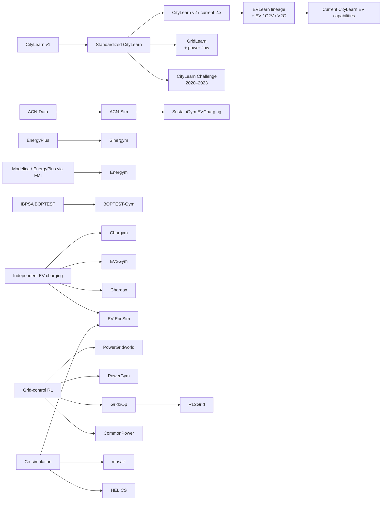

# Scoping Review of Simulation and Benchmarking Environments for MARL in Renewable Energy Communities and EV Charging

## Executive summary

This review examined reusable simulation and benchmarking environments relevant to **Multi-Agent Reinforcement Learning (MARL)** in Renewable Energy Communities (RECs), building energy management, EV charging, V2G/G2V, and grid-aware control. The final evidence matrix contains **20 records**, including environment families, benchmark series, RL environments, and co-simulation frameworks. The central finding is that the field is considerably richer than a simple comparison between CityLearn and a few EV simulators: the tools fall into distinct families that solve different parts of the real-world control problem.

At one end, **CityLearn** provides one of the clearest community-level environments for coordinated building and distributed-energy-resource control. Its current 2.x lineage supports MARL-oriented building coordination, and recent versions contain EV-related capabilities, electrical-service constraints, community settlement features, and an increasingly mature evaluation pipeline. CityLearn v2 substantially expanded the original framework, while the 2026 beta releases show that the codebase remains actively developed. citeturn15search0turn21search3turn15search3 **EVLearn** extends this lineage specifically toward EVs, charging infrastructure, G2V and V2G. citeturn17search0turn21search17 **GridLearn**, by contrast, branched from CityLearn to introduce grid-level power-flow considerations and voltage-related objectives. citeturn17search2turn17academia28

A separate family is much more specialized around EV charging. **SustainGym EVCharging**, built around ACN-Sim/ACN data, is particularly valuable because it uses actual charging-session data and physical charging-network models from Caltech and JPL. Its multi-agent version assigns agents to EVSEs, not transient EV sessions. This detail is scientifically important: EVs arrive and depart, but the MARL agent set remains the fixed charging-station set. citeturn15search2turn10view0turn10view1 **EV2Gym** provides a highly configurable EV/V2G environment with parameterizable transformers, charging stations and EVs, realistic open datasets, arrival/departure modeling, replay support and, in its current lineage, grid-voltage simulation. citeturn22view1turn16search2 **Chargax** takes a different direction, using JAX to prioritize simulation throughput; its paper reports computational speedups exceeding two to three orders of magnitude in its evaluated settings. citeturn16search1turn14academia18

The review therefore confirms an important distinction for the thesis:

> **Dynamic EV sessions are not the same as dynamic MARL populations.**

An EV can arrive, charge and leave while the simulator retains exactly the same charger objects, observation positions, action dimensions, and agent identifiers. SustainGym gives an especially explicit example because its PettingZoo agent set is tied to the EVSEs. Chargym similarly models random EV arrival/departure through a fixed set of charging spots. CityLearn/EVLearn can model changing EV states and connection events without this necessarily implying that a new MARL agent with a previously unknown observation/action interface has been created. citeturn10view1turn6view6turn7search0

A second major finding concerns **Scalability**. There is no defensible basis for saying that existing energy environments “do not scale.” Different environments already demonstrate very different kinds of scale. PowerGym includes benchmark networks extending to an 8500-node case; Grid2Op targets fast, reproducible large-scale power-flow experimentation; BOPTEST-Gym has introduced vectorized environments for parallel learning; EV2Gym parameterizes the number and topology of transformers, charging stations and EVs; and Chargax focuses explicitly on accelerated simulation. citeturn19search1turn19search7turn18search6turn22view1turn14academia18 The unresolved problem is instead **multi-dimensional scalability**: increasing population size, heterogeneity, physical complexity, dynamic reconfiguration and communication demands simultaneously while maintaining control quality and manageable computational/resource cost.

A third result substantially sharpens the thesis's claim about reconfiguration. It would be incorrect to state that energy simulation or co-simulation platforms are intrinsically unable to add or remove components at runtime. **HELICS is a strong counterexample.** Its current dynamic-federation model explicitly supports federates joining a running simulation; HELICS v3.4 supports late-joining federates that create arbitrary interfaces, and v3.5.1 supports disconnect/reconnect behavior. Its documentation explicitly motivates this with EVs entering and leaving a charging simulation and with real-time/HIL components joining only when needed. citeturn14search3

But this does **not** invalidate the thesis gap. HELICS solves dynamic composition at the **co-simulation infrastructure level**, not at the MARL-policy level. It does not by itself specify how a trained policy handles a newly introduced agent type, how observations and actions are mapped, how incompatible capabilities are represented, whether training remains valid, or how safety and robustness are preserved. This leads to a much stronger and more precise residual gap:

> **The missing capability is not dynamic component composition in isolation, but its integration with reusable MARL abstractions, heterogeneous observation/action interfaces, policy compatibility, physical constraints, lifecycle management, and reproducible evaluation.**

This is consistent with the findings from Deep Research A and B: individual pieces of the problem already have strong solutions; the scientifically interesting problem is their **joint treatment in operationally realistic distributed CPS**.

The review consequently recommends a **portfolio of benchmarks rather than a single competing simulator**. CityLearn should remain the primary REC/community benchmark because it is closest to the thesis domain and to your own simulator lineage. EV2Gym and SustainGym provide independent EV-focused validation. PowerGridworld and CommonPower test grid-aware heterogeneous and safe MARL assumptions. Chargax provides a useful simulator-throughput counterpoint. BOPTEST-Gym adds a higher-fidelity building-control reference. HELICS should be treated not as an algorithm benchmark but as a reference for dynamic co-simulation and future HIL/deployment experiments. citeturn15search0turn22view1turn15search2turn15search1turn18search2turn14academia18turn18search1turn14search3

## Review protocol

The review was performed on **August 12, 2026** as a structured **scoping review**. It deliberately does not claim to be an exhaustive systematic literature review. Public web search, official repositories, official project documentation, arXiv records, and primary publication pages were searched. **Scopus and Web of Science were not accessed**, so no artificial PRISMA-style database hit counts, deduplication counts, or exhaustive-coverage claims are reported.

The main date window was **2019–August 12, 2026**, corresponding approximately to the emergence of CityLearn and the current generation of Gym/Gymnasium-based energy environments. Older platforms were retained where they remain important to the current simulation architecture, particularly co-simulation frameworks.

The search proceeded through six conceptual groups:

| Search dimension | Representative search formulation |
|---|---|
| Energy MARL environments | `"multi-agent reinforcement learning" AND (energy OR smart grid OR building OR EV) AND (environment OR simulator OR benchmark)` |
| Named platforms | `CityLearn / EVLearn / GridLearn / PowerGridworld / SustainGym / Sinergym / BOPTEST + repository/documentation/paper` |
| EV simulation | `(EV charging OR V2G OR G2V) AND (Gym OR Gymnasium OR simulator OR benchmark OR JAX)` |
| Co-simulation and real-world fidelity | `(co-simulation OR digital twin OR hardware-in-the-loop) AND (smart grid OR EV charging)` |
| Dynamic populations | `(dynamic agents OR agent entry exit OR variable number OR reconfiguration) AND MARL AND energy` |
| Scalability/reproducibility | `(scalability OR throughput OR parallel OR vectorized OR reproducibility OR seed) + environment name` |

Primary sources were preferred throughout. For software capabilities this generally meant the official repository and documentation; for scientific claims it meant the original environment paper or official preprint. For example, CityLearn's current functionality was checked against its official repository, documentation and releases, while its scientific lineage was checked against the CityLearn papers. citeturn15search0turn15search3turn21search5 PowerGridworld was assessed from its NREL repository and original e-Energy citation, and SustainGym from its official repository and documentation. citeturn15search1turn15search2

A candidate was included when it satisfied four conditions: it was publicly reusable; it was relevant to building energy, RECs, EV charging or electrical-grid control; it exposed a sufficiently documented simulation or benchmarking interface; and it could either host RL/MARL controllers directly or provide a meaningful simulation/co-simulation layer for such controllers.

One-off experimental simulators without reusable public interfaces, generic non-energy MARL benchmarks, algorithm papers that merely used an existing simulator without contributing an environment, and duplicate forks without distinct capabilities were excluded.

### Operational definitions

The most important methodological choice was to avoid treating all forms of “dynamicity” as equivalent.

| Term | Definition used in this review |
|---|---|
| **Dynamic asset state** | A known asset remains part of the model but changes state, e.g. battery SoC or EV availability |
| **Fixed-slot session dynamics** | EV/user sessions start and end while chargers, slots or MARL agent identities remain fixed |
| **Variable scenario size** | The simulator can be instantiated with a different number of assets between runs |
| **Variable-set representation** | An algorithm/API can consume a changing collection of entities without relying on a permanently fixed padded roster |
| **Online agent entry/exit** | MARL agent identities actually appear or disappear while the environment is running |
| **True open heterogeneous population** | Previously absent agent types, capabilities or observation/action interfaces can enter or leave online without redesigning the controller contract |

This distinction is essential because the terms *dynamic*, *variable-size*, *scalable*, *multi-agent*, and *reconfigurable* are often used for quite different capabilities.

The same caution was used with **digital twin**. A simulator calibrated with real data or representing a real physical network was classified as a *data-driven digital replica* unless the primary source demonstrated live synchronization or a corresponding operational/HIL interface. This prevents an offline historical simulator from being treated as equivalent to a continuously synchronized operational twin.

The resulting corpus contains **20 records**. They are not 20 perfectly interchangeable Gym environments: the corpus deliberately includes benchmark programs such as the CityLearn Challenge and integration infrastructures such as HELICS because they address different dimensions of the simulator problem.

## Environment lineage and taxonomy

The landscape can be organized into five main families.

**District/community energy environments** are represented most clearly by CityLearn. CityLearn began as an OpenAI Gym environment for demand response and evolved toward standardized multi-building evaluation. Its current documentation describes it as a Gymnasium environment for MARL-oriented building energy coordination and demand response. CityLearn v2 adds substantially broader building/community capabilities, and the current repository remains active. citeturn15search0turn21search3turn21search5 The CityLearn Challenge then provided controlled benchmark problems; for example, the 2021 challenge used a nine-building microgrid, four years of hourly simulation data, and allowed either per-building agents or a centralized controller. citeturn7search7

EVLearn follows directly from this community-energy lineage by introducing EVs, charging infrastructure, associated flexibility and V2G/G2V simulation into the CityLearn context. citeturn17search0turn21search17 GridLearn took another branch: it extended the CityLearn idea toward grid-aware objectives by incorporating power flow and applying the environment to an IEEE 33-bus case. citeturn17search2turn17academia28

**EV-charging environments** form a separate family. SustainGym's EV environment builds on ACN-style data and charging-network models and offers both single-agent Gymnasium and multi-agent PettingZoo interfaces. citeturn15search2turn10view0 EV2Gym emphasizes configurability, V2G, open data, multiple controller families and, now, optional grid-voltage simulation. citeturn22view1 Chargax emphasizes accelerator-friendly simulation with JAX. citeturn16search1turn14academia18 Chargym is simpler, representing a fixed charging station with random EV sessions, making it useful precisely as an example of the difference between session dynamics and population reconfiguration. citeturn6view6

**Grid-aware RL environments** include PowerGridworld, CommonPower, PowerGym, and Grid2Op/RL2Grid. PowerGridworld is explicitly designed to create heterogeneous multi-device power-system MARL environments in which power-flow results can affect rewards. citeturn15search1 CommonPower combines single-agent and multi-agent RL, symbolic power-system models, MPC and safety layers, including examples in which heterogeneous controllers coexist. citeturn18search2turn18search5 PowerGym focuses specifically on Volt-VAR control and includes OpenDSS-based systems ranging from 13-bus cases to an 8500-node system. citeturn19search1 Grid2Op occupies a more system-operation-oriented niche and remains actively maintained; RL2Grid builds a standardized RL benchmark layer over it. citeturn19search7turn19search0turn19search3

**High-fidelity building environments** include Sinergym, BOPTEST-Gym and Energym. Sinergym exposes EnergyPlus through Gymnasium and provides benchmark environments, controller customization, experiment tooling and cloud/logging integration. citeturn18search0turn21search2 BOPTEST-Gym wraps IBPSA BOPTEST building emulators and now supports vectorized environments for parallel RL learning. citeturn18search1turn18search6 Energym uses FMI to provide standardized access to a library of Modelica and EnergyPlus-based building models, some calibrated against site data. citeturn19search6

Finally, **co-simulation environments** solve a different problem. Mosaik is a smart-grid simulation compositor designed to couple independent simulators into larger scenarios. citeturn18search3 HELICS is a distributed infrastructure co-simulation framework with explicit support for dynamic federations and HIL/real-time use cases. citeturn14search1turn14search3 EV-EcoSim specializes this general idea toward grid-aware EV-charging infrastructure by combining charging, storage, PV and distribution-system models. citeturn14search2

The resulting lineage is summarized below.



The arrows should be read as **software or conceptual lineage**, not necessarily direct code inheritance in every case. GridLearn explicitly describes itself as a CityLearn spin-off, whereas SustainGym's EV environment relies on ACN-derived physical/data models and HELICS/mosaik belong to a separate co-simulation tradition. citeturn17search2turn10view0turn18search3turn14search1

The Mermaid source is also available as a standalone file:

[Download the lineage Mermaid diagram](sandbox:/mnt/data/deep_research_c/DeepResearch_C_Lineage.mmd)

## Comparative evidence matrix

The full machine-readable matrix contains all requested fields. The following table condenses the most important dimensions.

**Legend:** “Config” means the dimension can be changed when constructing/resetting a scenario but is not demonstrated as runtime agent reconfiguration. “Framework” means the capability exists at simulation-infrastructure level rather than as an RL/MARL environment abstraction.

| Environment | Native MARL | EV/V2G | Session dynamics | Variable scenario size | Online RL-agent entry/exit | Grid physics | Real data / HIL | Main scalability evidence |
|---|---|---|---|---|---|---|---|---|
| **CityLearn 2.x** | Yes | Yes | Yes | Config | Not evidenced | Electrical constraints, not general feeder PF | Dataset-driven | Multi-building/community benchmark; canonical challenges used 9 buildings citeturn15search0turn15search3turn7search7 |
| **CityLearn Challenge** | Yes/centralized option | Edition-dependent | Edition-dependent | Fixed benchmark | No | No general PF | Benchmark datasets | Controlled multi-year evaluation; held-out test data citeturn7search5turn7search7 |
| **EVLearn** | Via CityLearn | Yes | Yes | Config | Not evidenced | No general PF | Data-driven | No dedicated simulator-throughput benchmark found citeturn17search0turn21search17 |
| **GridLearn** | Yes | Not native | No EV sessions | Config | Not evidenced | Yes | Mostly modeled | IEEE 33-bus published case citeturn17academia28 |
| **SustainGym EVCharging** | Yes | Charging-focused | Yes | Site/config | **No; EVSE agents fixed** | Charging-network constraints | **Real Caltech/JPL sessions** | 52/54 EVSE networks; 288 steps/day citeturn10view0turn10view1 |
| **ACN-Sim** | Not inherently | Charging-focused | Yes | Config | N/A | Charging-network constraints | Real ACN data | Real-site-scale charging networks citeturn2search4turn2search9 |
| **Chargym** | No native MARL evidence | Yes | Yes | Mostly fixed | No evidence | No | Limited | Canonical 10 charging spots citeturn6view6 |
| **EV2Gym** | Primarily Gym RL interface | **Yes** | Yes | **Yes, Config** | Not native | **Yes, current optional support** | Multiple open real datasets | N/topology parameterized; large scenarios supported citeturn22view1turn16search2 |
| **Chargax** | Not native MARL | EV charging | Yes | Config | No MARL semantics | No general PF | Real-data scenarios | **>100×–1000× reported simulator speedup** citeturn14academia18turn16search1 |
| **PowerGridworld** | **Yes** | Extensible | Not native | Config | Not evidenced | **Yes** | Mostly model-based | Heterogeneous multi-device MARL; RLlib/MADDPG examples citeturn15search1 |
| **CommonPower** | **Yes** | Extensible | Not native | Config | Not evidenced | Yes/symbolic + grid tooling | Flexible data interface | Heterogeneous controller composition; safety layer citeturn18search2turn18search5 |
| **Sinergym** | Primarily single-agent | No native | No | Model/config | No | No grid PF | Model/weather driven | Cloud/experiment execution rather than population scale citeturn18search0turn21search2 |
| **BOPTEST-Gym** | Primarily single-agent | No | No | Test-case | No | No grid PF | High-fidelity emulator | **Vectorized parallel environments** since v0.6 citeturn18search1turn18search6 |
| **PowerGym** | RL, not primarily MARL | No | No | Benchmark cases | No | **OpenDSS** | Standard feeders | **13/34/123 bus and 8500-node systems; parallel mode** citeturn19search1 |
| **Grid2Op** | Primarily grid-control RL | No | N/A | Multiple environments | No MARL-population semantics | **Yes** | Realistic chronics | Fast large-scale PF; active reproducibility support citeturn19search7turn19search0 |
| **RL2Grid** | RL benchmark | No | N/A | Multiple tasks | No | **AC PF via Grid2Op** | TSO-informed | Standardized multi-network task suite citeturn19search3 |
| **mosaik** | Controller-dependent | Via component | Component-dependent | Yes | Not established as MARL API | Via component | Component-dependent | Distributed multi-simulator composition citeturn18search3 |
| **HELICS** | Controller-dependent | Via federate | Yes if modeled | Yes | **Yes at federate level** | Via federate | **Real-time/HIL supported** | Dynamic distributed federation citeturn14search3turn14search0 |
| **EV-EcoSim** | Controller-dependent | Yes | Yes/modelled | Config | No MARL semantics evidenced | **Yes** | Scenario-dependent | Multi-timescale grid/EV co-simulation citeturn14search2 |
| **Energym** | Controller-agnostic | No | No | Model selection | No | No | Some site-calibrated models | 14 packaged building models citeturn19search6 |

A few observations are especially relevant.

CityLearn remains unusually strong as a **community-level coordination environment**, whereas many EV simulators are station-centric and many grid benchmarks are grid-operation-centric. CityLearn therefore still occupies an important niche even though other environments may have more detailed power-flow or charging-station models. citeturn15search0turn17academia28turn22view1

EV2Gym is a particularly useful independent comparator because it exposes parameterizable numbers and topology of transformers, charging stations and EVs; includes arrival/departure, heterogeneous EV specifications, battery degradation options, and multiple open datasets; and supports replay generation. The official repository also provides the exact publication metadata for the 2025 IEEE T-ITS paper. citeturn22view1turn22view2

SustainGym is valuable for an almost opposite reason: it provides a clean, concrete demonstration of how **realistic session dynamicity can coexist with a fixed agent population**. Its multi-agent implementation makes each charging station an agent and explicitly maintains a fixed possible-agent set. citeturn10view0turn10view1

PowerGridworld and CommonPower are important counterweights to any claim that energy MARL environments are necessarily homogeneous or detached from physical grid models. PowerGridworld explicitly targets heterogeneous composite power systems and calculates grid-level quantities through power flow; CommonPower supports heterogeneous controller assignments and symbolic safety-aware system models. citeturn15search1turn18search2

The complete evidence matrix, with all requested capability fields, is available in both machine-readable formats:

[Download the CSV evidence matrix](sandbox:/mnt/data/deep_research_c/DeepResearch_C_Evidence_Matrix.csv)

[Download the JSON evidence matrix](sandbox:/mnt/data/deep_research_c/DeepResearch_C_Evidence_Matrix.json)

## Reconfigurability and scalability audit

### EV arrival and departure are not sufficient evidence of agent reconfiguration

The most important counterexample is SustainGym. Its EVCharging environment contains historically grounded arrival and departure dynamics, but the physical EVSEs define the multi-agent entities. The documentation states that the agent set corresponds to the possible EVSE agents. An empty EVSE does not disappear as an agent because an EV drove away; it remains an EVSE awaiting another session. citeturn10view0turn10view1

Conceptually:

```text
EV A arrives
    ↓
occupies EVSE 12
    ↓
EV A departs
    ↓
EVSE 12 remains
    ↓
EV B later occupies EVSE 12
```

This is a dynamic **session** over a persistent control entity.

It is not:

```text
Agent A, with interface IA, joins the MARL system
    ↓
policy/controller infrastructure incorporates A
    ↓
A disappears
    ↓
previously unknown Agent B, with interface IB, joins
```

Chargym makes the same distinction visible through a simpler model: random EVs arrive and depart, but they use a fixed collection of charging spots. citeturn6view6

CityLearn's EV data model similarly contains states such as whether a vehicle is plugged in, incoming or commuting, plus expected departure and required state of charge. These are valuable temporal dynamics, but they do not by themselves prove that the MARL environment can create a new building/controller agent with a novel interface during an episode. citeturn7search0

Consequently, the thesis should avoid a sentence such as:

> “Existing simulators do not support EVs entering and leaving.”

That would be plainly wrong.

A defensible sentence is closer to:

> “Several existing environments model EV arrival, departure and changing asset availability. However, these mechanisms commonly operate over preconfigured assets, chargers or agent interfaces and therefore do not necessarily provide online composition of heterogeneous MARL agents.”

### Variable scenario size is not online entry and exit

EV2Gym provides a strong example of **configurable scale**. Its current repository states that the number and topology of transformers, charging stations and EVs are parameterizable and that EV arrival/departure, battery properties and heterogeneous EV specifications can be configured. citeturn22view1turn22view2

That is a substantial capability. But creating one experiment with 50 chargers and another with 150 does not imply that a trained policy can seamlessly continue operating when 100 new controller agents appear at timestep \(t\).

The distinction is:

```text
Variable scenario size
----------------------
reset/build env with N = 50
train/evaluate
destroy
build env with N = 150
train/evaluate
```

versus:

```text
Online population reconfiguration
---------------------------------
running system with N = 50
          ↓
new agents appear at runtime
          ↓
same operational system continues with N = 150
```

Downstream graph-based methods built around EV2Gym are interesting precisely because they attempt to remove some fixed-dimensional assumptions, but this is an **algorithmic representation property**, not automatically a property of the base environment API. The EV2Gym ecosystem itself highlights GNN and Decision Transformer extensions for scalability and changing problem sizes. citeturn16search10turn22view1

### Power-flow absence is not a defensible general gap

A claim that RL/MARL energy simulators generally omit electrical-grid physics is also too strong.

GridLearn explicitly adds power-flow modeling to a CityLearn-derived environment. citeturn17academia28 PowerGridworld was specifically designed around heterogeneous power-system MARL environments in which power-flow results affect costs/rewards. citeturn15search1 PowerGym relies on OpenDSS and provides physical distribution-network benchmark cases. citeturn19search1 Grid2Op provides a large-scale power-flow-based operational environment. citeturn19search7 Current EV2Gym releases also add optional grid-voltage simulation. citeturn16search2turn22view1

The real limitation is therefore integration. Very few environments simultaneously provide:

```text
REC-level assets
+ buildings
+ EV mobility/session behaviour
+ V2G
+ heterogeneous MARL agents
+ detailed grid physics
+ runtime reconfiguration
+ real data
+ safety/fault injection
+ lifecycle/deployment interfaces
```

That joint requirement is much closer to your thesis.

### “Scalable” cannot be treated as one property

The corpus contains several legitimate but non-equivalent scalability claims.

Chargax addresses **simulation throughput**, using JAX and reporting speedups greater than \(100\times\)–\(1000\times\) in its evaluated configurations. citeturn14academia18

PowerGym addresses **physical network size**, including an 8500-node feeder. citeturn19search1

BOPTEST-Gym addresses **parallel training throughput**, introducing vectorized environment support. citeturn18search6

EV2Gym addresses **configurability of system size**, allowing the number and topology of transformers, charging stations and EVs to be parameterized. citeturn22view1

Grid2Op addresses **large-scale sequential power-grid simulation** and reproducibility across operational chronics. citeturn19search7turn19search0

None of these alone tells us whether an MARL architecture scales when all of the following grow together:

\[
N_{\mathrm{agents}},
\quad
H_{\mathrm{agent}},
\quad
C_{\mathrm{environment}},
\quad
R_{\mathrm{reconfiguration}},
\quad
M_{\mathrm{communication}},
\]

while keeping under control:

\[
T_{\mathrm{train}},
\quad
L_{\mathrm{inference}},
\quad
B_{\mathrm{communication}},
\quad
M_{\mathrm{memory}},
\quad
J_{\mathrm{control}}.
\]

This directly supports the revised RQ2 formulation from the previous review: **multi-dimensional scalability**, not merely maximum agent count.

### HELICS is the most important counterexample to a blanket reconfiguration gap

HELICS deserves special treatment because it prevents us from making an overly broad claim.

Its current documentation defines dynamic federations in progressively stronger levels. It specifically gives the example of EV federates joining a running power-system simulation to charge and leaving afterward. HELICS v3.4 supports the creation of arbitrary interfaces by late-joining federates, and v3.5.1 adds disconnect/reconnect support. The same documentation connects these features to real-time and HIL scenarios. citeturn14search3

That means the statement:

> “Existing cyber-physical simulation platforms cannot dynamically add or remove components during execution.”

is false.

However, HELICS provides:

```text
dynamic component/federate composition
```

not automatically:

```text
dynamic MARL policy compatibility
+ observation/action adaptation
+ heterogeneous policy selection
+ online learning
+ safety preservation
+ performance guarantees
```

This is actually beneficial for the thesis. It allows Chapter 2 to separate an **infrastructure problem that has credible solutions** from the **learning-and-control problem that remains open**.

## Residual research gaps

The gap assessment is deliberately conservative. “Strong” means that the conclusion is well supported **within the reviewed corpus** and survived explicit counterexample searches; it does not mean a proof that no unpublished or unindexed work exists.

| Residual gap | Confidence | Justification |
|---|---|---|
| **Open heterogeneous MARL populations in energy environments** | **Strong** | The MARL-oriented energy benchmarks reviewed support fixed agents, configurable populations, session dynamics, or heterogeneous predefined entities, but no included MARL benchmark demonstrated previously unknown agent types with new observation/action interfaces joining and leaving online. HELICS demonstrates this at co-simulation-federate level, not at learned-policy level. citeturn10view1turn15search1turn14search3 |
| **Clear separation and benchmarking of session dynamics, asset availability and agent lifecycle** | **Strong** | SustainGym, Chargym, CityLearn/EVLearn and EV2Gym all demonstrate why “EV enters/leaves” can refer to different abstractions. The literature/tooling does not expose one standard reconfiguration taxonomy or benchmark protocol across them. citeturn10view0turn6view6turn7search0turn22view1 |
| **Multi-dimensional scalability benchmarks** | **Moderate** | Strong counterexamples exist for individual dimensions—large grids, configurable EV populations, vectorized simulation and GPU/JAX speed—but no common protocol found jointly measures population, heterogeneity, communication, reconfiguration, physical fidelity, training cost and inference cost. citeturn19search1turn18search6turn14academia18turn22view1 |
| **Integrated REC + EV + grid-physics + heterogeneous-MARL benchmark** | **Moderate** | The components exist separately: CityLearn for communities, EV2Gym/SustainGym for charging, GridLearn/PowerGridworld for power flow, and CommonPower for safe heterogeneous control. The corpus did not reveal one mature benchmark combining all of them. Because the search was a scoping review without Scopus/WoS exhaustiveness, “moderate” is safer than “strong.” citeturn15search0turn22view1turn15search1turn18search2 |
| **RL-ready dynamic co-simulation/HIL benchmark** | **Moderate** | HELICS already provides the underlying dynamic-federation and HIL mechanisms, so the gap is not infrastructure availability. The missing layer is a standardized MARL observation/action/lifecycle benchmark over that infrastructure. citeturn14search3turn14search0 |
| **Cross-environment reproducibility protocol** | **Moderate** | Several environments have strong reproducibility mechanisms—CityLearn challenge datasets, EV2Gym replay, BOPTEST test cases, Grid2Op seed handling—but the definitions of seeds, stochastic session generation, environment configuration and physics differ substantially. citeturn7search5turn22view1turn18search1turn19search0 |
| **A standardized definition of an operational “digital twin” for MARL benchmarking** | **Tentative** | Some environments are data-calibrated or reproduce physical networks, while HELICS supports real-time/HIL integration. Whether the community needs a formal unified digital-twin benchmark is plausible but cannot be established strongly from this corpus alone. citeturn10view0turn14search3 |

The **strongest conclusion for Chapter 2** should therefore not be that existing simulators are simplistic. In fact, many of them are sophisticated.

A more accurate synthesis is:

> Existing energy-control environments provide mature support for several individual requirements, including realistic EV sessions, multi-building coordination, V2G, grid-aware control, large networks, high-throughput simulation, physical constraints, real-world datasets and distributed co-simulation. The residual challenge lies in combining these capabilities in a reproducible environment that treats heterogeneous and dynamically reconfigurable MARL populations as first-class entities while preserving physical validity, scalability and a path toward operational deployment.

That formulation is substantially harder to attack because it explicitly acknowledges the counterexamples.

## Recommended benchmark portfolio for the thesis

I would **not** make the thesis's evaluation depend on showing that EnergAIze/your CityLearn extensions outperform every simulator. Different tools represent different experimental questions.

Instead, the benchmark strategy should be role-based.

| Environment | Recommended role in the thesis | Why it earns a place |
|---|---|---|
| **CityLearn current 2.x** | **Primary REC benchmark and reference implementation** | Closest match to the thesis domain; multi-building coordination, DERs, current EV functionality, established benchmark lineage, and direct continuity with your simulator contributions. Current development remains active through the 2.6 beta line. citeturn15search0turn15search3turn21search5 |
| **EV2Gym** | **Independent EV/V2G comparator** | Avoids validating EV functionality only against your own CityLearn lineage. Supports configurable EV/station/transformer topology, open real-world datasets, arrival/departure, V2G, replay and current optional grid simulation. citeturn22view1turn22view2 |
| **SustainGym EVCharging** | **Real-data session-dynamics and multi-agent reference** | Uses Caltech/JPL charging data and physical charging-network models; its fixed EVSE-agent semantics make it an ideal controlled comparison for distinguishing session dynamics from agent-population reconfiguration. citeturn10view0turn10view1 |
| **PowerGridworld** | **Grid-aware heterogeneous MARL reference** | Explicitly targets heterogeneous multi-device MARL with power-flow-derived grid variables/costs. It tests whether architectural ideas generalize beyond building-level energy balancing. citeturn15search1 |
| **CommonPower** | **Safety and hybrid-controller reference** | Particularly relevant if Chapter 6 survives as an independent safety chapter: it supports symbolic models, safety layers, MARL, MPC and heterogeneous controller assignments. citeturn18search2turn18search5 |
| **Chargax** | **Simulation-throughput/scalability comparator** | Useful when evaluating the simulator contribution itself. A JAX-oriented implementation provides a credible counterpoint to CPU-centric simulation and prevents vague claims about simulator performance. citeturn14academia18turn16search1 |
| **BOPTEST-Gym** | **Building-physics/fidelity reference** | Provides a standardized building-emulator benchmark and parallel/vectorized learning support. It is useful for discussing the fidelity–throughput trade-off even if it is not the main MARL environment. citeturn18search1turn18search6 |
| **HELICS** | **Dynamic co-simulation/HIL reference, not algorithm leaderboard** | Provides the strongest infrastructure-level comparator for online component composition, distributed simulation and HIL. It should be used to frame deployment/reconfiguration capabilities rather than to compare RL reward directly. citeturn14search3turn14search1 |

This does **not** imply eight complete experimental campaigns. A sensible thesis design would distinguish **core experimental benchmarks** from **reference architectures**.

For the quantitative chapters, the likely core is:

```text
CityLearn / EnergAIze environment
        +
EV2Gym
        +
SustainGym EVCharging
        +
PowerGridworld or CommonPower
```

Chargax can be introduced specifically for **simulator performance**, while BOPTEST-Gym can anchor the discussion of **physics fidelity** and HELICS the discussion of **runtime composition/HIL**.

I would not prioritize GridLearn as a new experimental baseline unless there is a specific reason to reproduce its IEEE-33-bus setup. Its conceptual contribution—adding grid-aware power flow to the CityLearn lineage—is important for the state of the art, but newer environments such as PowerGridworld, EV2Gym's current grid integration, CommonPower, PowerGym and Grid2Op give broader alternative reference points. GridLearn should nonetheless remain cited because it is historically and conceptually close to CityLearn. citeturn17academia28turn15search1turn22view1

Sinergym is also valuable but somewhat orthogonal to the main thesis. It is a strong EnergyPlus-based building-control benchmark with mature experiment tooling, but it is less directly aligned with REC-level heterogeneous MARL and EV population reconfiguration. citeturn21search2 If a later experiment specifically needs EnergyPlus-based thermal fidelity, Sinergym becomes a stronger candidate.

## Research artifacts and bibliography

The review artifacts have been prepared in forms that can be incorporated into the thesis workflow.

| Artifact | File |
|---|---|
| Complete deliverable bundle | [Download all Deep Research C deliverables](sandbox:/mnt/data/DeepResearch_C_Deliverables.zip) |
| Full evidence matrix | [CSV](sandbox:/mnt/data/deep_research_c/DeepResearch_C_Evidence_Matrix.csv) |
| Full evidence matrix | [JSON](sandbox:/mnt/data/deep_research_c/DeepResearch_C_Evidence_Matrix.json) |
| Transparent review protocol | [Protocol](sandbox:/mnt/data/deep_research_c/DeepResearch_C_Protocol.md) |
| One-page narrative summary | [Executive summary](sandbox:/mnt/data/deep_research_c/DeepResearch_C_Executive_Summary.md) |
| Mermaid source | [Lineage diagram](sandbox:/mnt/data/deep_research_c/DeepResearch_C_Lineage.mmd) |
| BibTeX-ready bibliography | [Bibliography](sandbox:/mnt/data/deep_research_c/DeepResearch_C_Bibliography.bib) |

The BibTeX file includes the central environment papers and software records, including the CityLearn lineage, EVLearn, GridLearn, SustainGym, EV2Gym, Chargax, PowerGridworld, Sinergym, BOPTEST-Gym, PowerGym, RL2Grid, Energym, CommonPower, Grid2Op, HELICS, mosaik and EV-EcoSim. For the most important current references, metadata was cross-checked against the primary project's own citation information. CityLearn's current documentation supplies the full 15-author citation for CityLearn v2 and the final journal metadata. citeturn21search5 EV2Gym's official repository supplies its exact IEEE citation—Stavros Orfanoudakis, Cesar Diaz-Londono, Yunus Emre Yılmaz, Peter Palensky and Pedro P. Vergara, *IEEE Transactions on Intelligent Transportation Systems*, 26(2), 2410–2421. citeturn22view2 Sinergym's official repository likewise provides its five-author Energy and Buildings citation. citeturn21search2

The evidence gathered here is now sufficient to replace the provisional parts of **Section 2.6 — Simulation, Benchmarking, and Experimental Environments** with a source-backed comparison and to strengthen Sections 2.7–2.9 without claiming that current environments lack capabilities that the review has shown already exist.