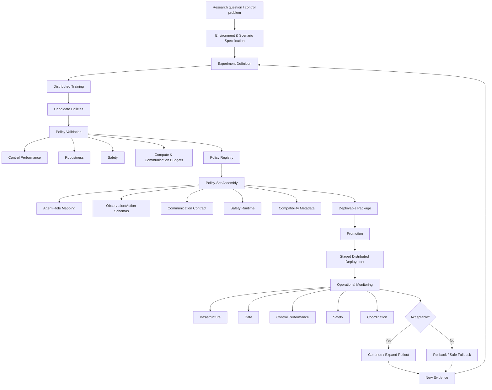
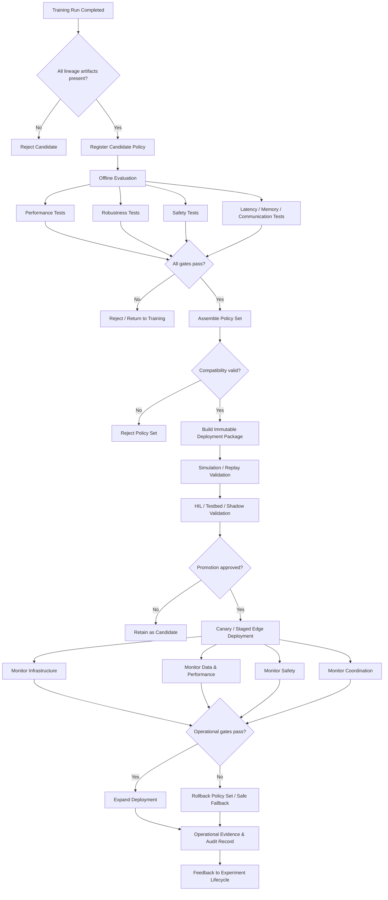

# Scoping Review: MARL Lifecycle, RLOps/MLOps, and Distributed Edge Deployment in Real-World CPS

## Executive summary

This scoping review changes the deployment argument of the thesis in an important way.

The literature does **not** support a broad claim that reinforcement learning lacks lifecycle tooling, that MARL has never been deployed in a real cyber-physical system, or that existing infrastructure cannot update and roll back software at the edge. All three claims have strong counterexamples.

First, an explicit **RLOps** concept already exists. Li et al. define an RL-specific lifecycle spanning model specification, development, production serving, operations monitoring, and safety/security, and describe an implemented Open-RAN-oriented platform intended to make that process automated and reproducible. citeturn16search3turn16search5

Second, there is now unusually strong evidence of **operational MARL**. The I-24 variable-speed-limit system deployed simulation-trained MARL control over a 17-mile freeway segment with 67 VSL controllers. The original field paper reported roughly ten million decisions by April 2024, while the subsequent assessment reports approximately 35 million control decisions over about 28 million trips during six months of operation. Invalid-action masking and independent runtime safety guards were part of the deployed control stack. citeturn15search0turn15search4

Third, general MLOps and edge infrastructure is already mature in many of the individual mechanisms that a MARL lifecycle needs. MLflow and Weights & Biases provide experiment and artifact lineage and versioned registries; Kubernetes, Helm, and Argo provide rollout and rollback primitives; BentoML distinguishes a deployable package from a bare model; KubeEdge extends Kubernetes-style application and device management to edge nodes; AWS IoT Greengrass supports explicit rollback on failed deployments; Azure IoT Edge manages and monitors the lifecycle of remotely deployed edge modules. citeturn14search16turn14search3turn19search0turn19search2turn19search5turn19search7turn18search0turn18search5turn18search2

The **strong residual gap is therefore not generic MLOps**. It is the lack of a mature, reusable operations layer in which the unit being governed is a **coordinated MARL policy set**, rather than merely an individual model or container. Such a policy set needs to preserve relationships among policies, agent roles, observation and action schemas, environment and scenario versions, reward definitions, communication assumptions, safety mechanisms, and compatibility constraints.

This distinction matters. RLlib and MARLlib already support multiple policies and flexible mappings between agents and policies; MALib manages populations of policies during population-based MARL training. Those are important counterexamples to claims that multi-policy management itself is absent. But these mechanisms are principally **learning/runtime abstractions**, not production policy registries with promotion, compatibility checking, staged deployment, monitoring, and rollback semantics. citeturn15search2turn15search3

Similarly, infrastructure for **dynamic composition** already exists. HELICS explicitly supports dynamic federations in which federates join after a co-simulation starts; its own documentation uses EV federates joining and leaving a running co-simulation as an example. The missing piece is not the ability to instantiate a new distributed component. It is deciding whether that component is compatible with a learned control system, which policy it should receive, which interfaces it must expose, which safety requirements apply, and how its arrival affects the other active policies. citeturn18search3turn18search7

The review therefore identifies the strongest research opportunities for Chapter 7 as:

| Residual problem | Confidence |
|---|---:|
| Versioned MARL **policy-set registry** with compatibility metadata | **Strong** |
| Coordinated/atomic policy-set promotion and rollback | **Strong** |
| Coordination failures as first-class production monitoring signals | **Strong** |
| Edge deployment under disconnection while preserving policy-set consistency | **Strong** |
| Lifecycle support for true open heterogeneous agent populations | **Strong** |
| Replicated long-duration operational MARL evidence across CPS domains | **Strong** |
| Coupled versioning of policy, environment, scenario, reward and schemas | **Moderate** |
| Standard performance–robustness–safety–resource promotion gates | **Moderate** |
| Standard deployable package contract for policy + control semantics | **Moderate** |
| Formal safety assurance as a generic lifecycle primitive | **Tentative** |

The resulting thesis position should consequently be **integration-oriented rather than absence-oriented**:

> Existing research and production systems provide substantial parts of the RL/MARL lifecycle independently, including distributed training, experiment tracking, model registries, packaging, scalable serving, progressive deployment, rollback, edge orchestration, runtime safety mechanisms, and even sustained operational MARL. The residual challenge is to integrate these capabilities into a reproducible lifecycle that treats coordinated policy sets, agent-policy compatibility, dynamic heterogeneous populations, safety constraints, and distributed edge operation as first-class entities.

That is a much stronger and more defensible basis for EnergAIze than saying that “MLOps for MARL does not exist.”

The complete extraction artifacts contain **38 curated records**: 20 research/deployment papers or research systems and 18 general lifecycle, orchestration, serving, CPS, or edge platforms.

**Research artifacts**

[Download the complete evidence matrix — CSV](sandbox:/mnt/data/marl_rlops_deep_research_d/evidence_matrix.csv)

[Download the complete evidence matrix — TSV](sandbox:/mnt/data/marl_rlops_deep_research_d/evidence_matrix.tsv)

[Download the tool comparison matrix](sandbox:/mnt/data/marl_rlops_deep_research_d/tool_comparison.csv)

[Download the counterexample matrix](sandbox:/mnt/data/marl_rlops_deep_research_d/counterexamples.csv)

[Download the residual-gap matrix](sandbox:/mnt/data/marl_rlops_deep_research_d/residual_gaps.csv)

[Download the review protocol](sandbox:/mnt/data/marl_rlops_deep_research_d/protocol.md)

[Download the complete Deep Research D evidence bundle](sandbox:/mnt/data/MARL_RLOps_Deep_Research_D_Evidence_Bundle.zip)

## Review protocol and corpus

### Review questions

The review was organized around five questions rather than around individual software products.

**Review question A.** Which lifecycle stages have actually been specified or implemented for RL and MARL, from experiment specification to production monitoring?

**Review question B.** Which mechanisms already exist for experiment lineage, policy/model storage, registry, packaging, promotion, deployment, rollback, and monitoring?

**Review question C.** What level of evidence exists for distributed or edge deployment in physical and operational CPS?

**Review question D.** Which general MLOps and edge-computing mechanisms transfer directly to MARL, and which MARL-specific semantics remain unsupported?

**Review question E.** What evidence exists for lifecycle management when the participating agents or physical components change dynamically, especially when the population is heterogeneous?

This deliberately separates two questions that are easily confused:

\[
\text{Can infrastructure deploy several models?}
\]

from:

\[
\text{Can infrastructure correctly govern an interdependent MARL policy set?}
\]

The first already has many positive answers. The second is where substantially stronger residual gaps emerged.

### Search strategy

The search cut-off was **August 13, 2026**. The main deployment window was 2016–2026, with earlier/foundational sources admitted when directly needed to establish the lineage of a framework.

Queries combined four families of terms:

```text
Learning:
"reinforcement learning"
"multi-agent reinforcement learning"
RL
MARL
CTDE

Lifecycle:
MLOps
RLOps
lifecycle
experiment tracking
model registry
policy registry
packaging
serving
deployment
promotion
rollback
monitoring

Distribution:
distributed
edge
fleet
Kubernetes
cloud-native
orchestration
offline
federated

CPS / domains:
cyber-physical
robotics
transportation
energy
Open RAN
IoT
industrial
```

Representative searches took forms such as:

```text
("reinforcement learning" OR "multi-agent reinforcement learning" OR MARL)
AND
(MLOps OR RLOps OR lifecycle OR registry OR deployment OR monitoring OR rollback)
```

and:

```text
"multi-agent reinforcement learning"
AND
("field deployment" OR "real-world" OR operational OR edge)
```

Tool-specific searches were then performed against first-party documentation for experiment tracking, registry functionality, packaging, serving, rollout/rollback, monitoring, distributed execution, and edge deployment.

The source set emphasized **primary sources**: arXiv/original papers, IEEE Xplore, JMLR, primary publisher pages, official project documentation, official vendor documentation, and official project repositories. For example, the review uses the original RLOps paper rather than a later MLOps survey, the primary I-24 deployment papers rather than news coverage, the JMLR papers for MARLlib/MALib/Pearl, and first-party documentation for MLflow, Kubernetes, Greengrass, Azure IoT Edge, HELICS, and the other deployment systems. citeturn16search3turn15search0turn15search2turn15search3turn16search0

### Inclusion and exclusion

A source was retained when it was either:

1. a primary research contribution that implemented, evaluated, or operationally deployed relevant RL/MARL lifecycle functionality; or
2. first-party documentation for a system that provides a lifecycle, serving, orchestration, edge, monitoring, or rollback capability that could form part of a MARL stack.

Pure algorithm papers were generally excluded unless they contributed direct evidence about operationalization, safety, distributed execution, or physical deployment.

Secondary surveys were useful for discovery but were not used as the primary evidentiary basis for the extraction matrix.

The review deliberately excludes the currently fashionable use of the word *agent* for LLM workflows unless the underlying system is actually relevant to reinforcement learning infrastructure. “Multi-agent” in this report means the RL/CPS sense used in the thesis.

### Evidence levels

Three deployment levels are distinguished:

| Level | Interpretation |
|---|---|
| **Simulation/research** | Algorithm or infrastructure demonstrated without physical CPS operation |
| **Testbed/physical** | Execution on actual devices, laboratory hardware, HIL, or a controlled physical environment |
| **Operational** | Integrated into a real operational system and used during actual system operation |

This distinction is particularly important for the I-24 work. It is not merely a simulation-to-real experiment: the 2024 paper describes field deployment onto 67 VSL controllers, and the follow-up paper reports sustained operational assessment over six months. citeturn15search0turn15search4

### Population-dynamics vocabulary

The same six-level vocabulary used elsewhere in the thesis was maintained:

```text
none
session-level
asset-availability
variable-size
online-entry-exit
true-open-heterogeneous
```

Importantly, **MALib's policy population is not categorized as an open CPS agent population**. MALib is explicitly a population-based MARL framework in which policy populations and policy combinations are managed during learning. That does not by itself mean new physical controllers with previously unseen interfaces can join an operational system. citeturn15search3turn15search7

Likewise, a dynamic HELICS federation **does** provide online participant composition at the simulation/co-simulation layer, but it does not automatically solve policy compatibility, observation/action schemas, safety, or learned coordination. citeturn18search3

### Corpus structure

The full matrix contains 38 records. The following is a condensed view of the most informative primary records; the downloadable CSV/TSV contains all requested fields for every record.

| ID | Study/system | Paradigm | Evidence | Lifecycle significance |
|---|---|---|---|---|
| A01 | RLOps/Open RAN | RL | Implemented platform | Explicit RL-specific lifecycle |
| A02 | I-24 field deployment | MARL | **Operational** | 67 real controllers + runtime guards |
| A03 | I-24 six-month assessment | MARL | **Operational** | Long-duration operational evidence |
| A05 | Acme | RL | Distributed research | Actor/learner architecture and reproducibility |
| A06 | RLlib | RL/MARL | Distributed framework | Multi-policy mapping + scalable training |
| A09 | Mava | MARL | Distributed research | MARL-specific distributed implementation |
| A10 | MARLlib | MARL | Distributed research | Standardized MARL policy mapping |
| A11 | MALib | MARL | Distributed research | Policy-population orchestration |
| A13 | Pearl | RL | Production-oriented | Applied/production RL library |
| A14 | ElegantRL-Podracer | RL | Cloud testbed | Kubernetes/cloud-native RL training |
| A15 | SensiX++ | ML edge | Physical edge | Multi-model MLOps on Jetson/Coral |
| A16 | FedOps | FL | Distributed platform | Heterogeneous-client operations |
| A18 | Autonomous drone racing | RL | Physical CPS | Onboard real-world RL |
| S14 | HELICS | CPS infrastructure | Dynamic distributed co-sim | Online federate join/leave |
| S16 | KubeEdge | Edge infrastructure | Operational platform | Cloud-edge orchestration |
| S17 | Greengrass | Edge infrastructure | Operational platform | Fleet deployment + rollback |
| S18 | Azure IoT Edge | Edge infrastructure | Operational platform | Module lifecycle + monitoring |

RLOps is particularly important because it means Chapter 7 should not present “an RL lifecycle” itself as novel. The paper already describes model specification, development, serving, operations monitoring, and safety/security as part of an RL-specific lifecycle. citeturn16search3

Likewise, Pearl describes itself as a production-ready RL library and supports distributed training, testing, and evaluation. ElegantRL-Podracer goes further on cloud-native training, using containerization, microservices, and a Kubernetes-oriented orchestration scheme. These systems weaken any claim that RL engineering ends at a notebook or a model checkpoint. citeturn16search0turn16search1turn17search1

What they do **not** establish is the full operational semantics needed for a dynamically reconfigurable heterogeneous MARL CPS.

## Lifecycle taxonomy and deployment patterns

### The lifecycle should govern more than a model

The central conceptual result of the review is that a MARL lifecycle needs several nested units of identity.

A conventional model identifier such as:

```text
model = policy_42.pt
```

is inadequate for a thesis in which several policies interact with changing physical agents.

A more useful hierarchy is:

```text
Experiment
    ├── source revision
    ├── algorithm configuration
    ├── seeds
    ├── training environment
    ├── scenarios
    ├── reward definition
    └── resulting policy candidates

Policy
    ├── learned parameters
    ├── architecture
    ├── preprocessing
    ├── observation schema
    ├── action schema
    └── compatibility requirements

Policy set
    ├── policy A
    ├── policy B
    ├── policy C
    ├── agent-role → policy mapping
    ├── communication contract
    ├── joint compatibility constraints
    └── safety/runtime dependencies

Deployment
    ├── policy-set version
    ├── runtime/container version
    ├── target agents/devices
    ├── configuration
    ├── rollout strategy
    └── rollback predecessor
```

MLflow already tracks parameters, code versions, metrics, and output artifacts, while its registry adds model lineage, versions, aliases, tags, and governance metadata. W&B similarly manages artifact versions, lineage and model promotion. These are strong foundations, but neither first-party description makes “a coordinated MARL policy set with agent-role and interface compatibility” its native semantic unit. citeturn14search16turn14search3turn19search0turn19search4

The resulting taxonomy is:



### Experiment tracking is not a reproducible lifecycle

This distinction should be explicit in Chapter 7.

**Experiment tracking** records what happened during a run: parameters, metrics, artifacts, code revisions, timestamps, and related metadata. MLflow and W&B provide this very well; Ray Tune additionally manages distributed experiments, trial checkpoints, result analysis, persistent storage, and fault-tolerance mechanisms. citeturn14search16turn19search4turn14search20turn14search4turn14search11

A **reproducible RL lifecycle**, however, must also be able to reconstruct the world in which a policy was learned. At minimum, this includes the environment implementation, scenario/data version, observation and action semantics, reward definition, constraints, random seeds, agent-policy mapping and training code. This interpretation is consistent with RLOps' argument that RL requires a systematic specification, development, testing, serving, monitoring, and safety lifecycle rather than only model training. citeturn16search3

For EnergAIze, the practical rule should therefore be:

> A run is not considered reproducible merely because its metrics and checkpoint exist. It is reproducible only when the policy can be associated unambiguously with the environment, scenario, interfaces, reward, constraints, algorithm configuration, source revision and runtime used to produce it.

### Model storage is not a policy registry

A **model store** answers:

> Where are the bytes?

A **registry** additionally answers:

> Which version is this, where did it come from, what is its status, and which metadata and lineage belong to it?

MLflow's Model Registry explicitly supplies centralized model management, lineage, versioning, aliases and metadata. W&B's Registry similarly versions artifacts, tracks lineage, and supports promotion through lifecycle stages and automation. citeturn14search3turn19search0turn19search8

A **MARL policy-set registry** must answer still more:

> Which policies are allowed to operate together?

and:

> Which agents, capabilities, interfaces and runtime dependencies is this policy set compatible with?

This is the crucial additional semantic layer.

RLlib and MARLlib demonstrate that flexible agent-to-policy mappings are feasible at the MARL framework level. MARLlib explicitly identifies flexible policy mapping as one of its core mechanisms. citeturn15search2

The research opportunity is therefore not inventing policy mapping, but **making the mapping governable, versioned, deployable and verifiable across the lifecycle**.

### Serialization is not packaging

A serialized PyTorch/JAX checkpoint is an implementation artifact.

A deployment package needs more than learned weights. BentoML provides a useful counterexample to the idea that “saving the model” is sufficient: a Bento can package source code, Python dependencies, model references, and environment setup and can then be converted into an OCI-compliant container. citeturn19search7turn19search3

For a CPS policy, the deployable object should ideally contain or reference:

```text
policy weights
policy architecture
pre/post-processing
observation schema
action schema
communication schema
runtime dependencies
safety layer / action guard
configuration
policy-set manifest
compatibility constraints
artifact checksums
source/environment lineage
```

The I-24 deployment reinforces this point from another direction: its operational controller was not merely a neural policy. Invalid-action masking and safety guards were integral to the real control solution. citeturn15search0

### Multi-model serving is not coordinated MARL deployment

Ray Serve supports scalable serving and composition of deployed services, and Seldon provides production-oriented model-serving and monitoring capabilities. These systems demonstrate that serving many models is no longer technically unusual. citeturn1search8turn11search7turn11search14

But a MARL policy set has a property a generic collection of models does not necessarily have:

\[
\pi_1,\pi_2,\ldots,\pi_n
\]

may be **behaviorally interdependent**.

Suppose agents \(A\), \(B\), and \(C\) currently run policy-set version 7. Updating \(A\) to policy version 8 while \(B\) and \(C\) remain at version 7 may be technically valid from the container platform's perspective while being behaviorally invalid from the control system's perspective.

That makes this configuration:

```text
A → π8
B → π7
C → π7
```

potentially different from either:

```text
A → π7
B → π7
C → π7
```

or:

```text
A → π8
B → π8
C → π8
```

The deployment system therefore needs to know whether mixed versions are permitted. None of the generic registry/serving systems in the curated corpus natively treats this as a MARL-specific compatibility problem; this is a synthesis from their documented deployment units and the multi-policy abstractions provided by MARL libraries. citeturn14search3turn19search0turn15search2

### Deployment patterns

Four patterns should be kept distinct.

| Pattern | Training/control structure | Main operational implication |
|---|---|---|
| **Centralized** | Central training and/or central inference | Simpler policy consistency; communication and central-failure dependencies |
| **Hierarchical** | Central/community coordination with local controllers | Different policy classes and update schedules |
| **Federated** | Distributed learning with central aggregation | Client heterogeneity, synchronization and communication become lifecycle concerns |
| **Edge-native decentralized** | Policies execute independently close to assets | Offline operation, fleet consistency, compatibility and rollback become critical |

FedOps is a useful adjacent-domain reference because it explicitly tackles heterogeneity management in federated-learning operations. It does not solve MARL deployment, but it shows that distributed participant heterogeneity can itself be elevated to an operations concern rather than treated as an algorithm-only detail. citeturn17search3turn17search11

KubeEdge, Greengrass and Azure IoT Edge provide different implementations of the edge-native infrastructure layer. KubeEdge extends Kubernetes orchestration and device management to edge hosts; Greengrass manages versioned components and supports rollback on deployment failure; Azure IoT Edge's agent instantiates, maintains and reports the state of deployed modules and can continue operating as an edge runtime. citeturn18search0turn18search5turn18search2turn18search10

### Monitoring must be split into five categories

For the thesis, “monitoring” should never appear as a single undifferentiated feature.

| Category | Example signals |
|---|---|
| **Infrastructure** | CPU, GPU, RAM, disk, temperature, process health, network availability |
| **Data** | missing observations, delays, out-of-range values, schema changes, distribution drift |
| **Control performance** | reward/KPIs, energy cost, peak power, comfort, tracking error |
| **Safety** | constraint violations, guard interventions, unsafe proposals, fallback activation |
| **Coordination** | oscillation, deadlock, conflicting actions, fairness, stale messages, loss of cooperation |

Generic edge systems already provide substantial infrastructure and deployment-state monitoring. Azure IoT Edge, for instance, exposes runtime metrics and module status, while Greengrass exposes deployment/component state. citeturn18search18turn18search21

The I-24 case illustrates why this does not exhaust MARL monitoring: the deployed controller separately tracks whether policy actions are accepted or modified by safety guards, making the interaction between learned behavior and operational constraints observable. citeturn15search0turn15search4

That fifth category — **coordination monitoring** — is the one least well served by generic platforms.

## Evidence and counterexamples

The review was deliberately adversarial toward the thesis. Rather than only looking for papers that support the intended contribution, it searched for evidence that makes common gap claims false.

### Counterexample matrix

| Claim that should **not** appear in the thesis | Assessment | Counterevidence |
|---|---|---|
| “MARL has never been deployed in a real operational CPS.” | **False** | I-24 deployed MARL over 67 VSL controllers on a 17-mile freeway; follow-up assessment covers six months and about 35M decisions. citeturn15search0turn15search4 |
| “There is no RL-specific lifecycle beyond MLOps.” | **False** | RLOps explicitly specifies RL development, serving, monitoring, safety/security and reproducibility. citeturn16search3 |
| “Production-oriented RL tooling does not exist.” | **False** | Pearl explicitly targets production-ready RL; RLlib and Acme provide mature distributed RL abstractions. citeturn16search0turn8search1turn9search0 |
| “MARL frameworks cannot manage multiple policies.” | **False** | MARLlib provides flexible policy mapping; MALib explicitly manages policy populations/combinations. citeturn15search2turn15search3 |
| “MLOps registries are just file stores.” | **False** | MLflow and W&B registries provide versioning, lineage and lifecycle metadata/promotion functionality. citeturn14search3turn19search0 |
| “Container orchestration cannot roll back a bad update.” | **False** | Kubernetes retains deployment history and provides rollback; Argo adds canary/blue-green progression and rollback controls. citeturn19search2turn19search5turn19search9 |
| “Edge fleet systems cannot automatically roll back software.” | **False** | Greengrass's documented failure-handling policy includes `ROLLBACK`. citeturn18search1turn18search5 |
| “Dynamic composition is absent from distributed CPS simulation.” | **False** | HELICS dynamic federations permit federates to join after execution starts and explicitly document EV join/leave. citeturn18search3 |
| “A variable policy population proves open physical-agent support.” | **False conflation** | MALib manages dynamic policy populations/combinations; that is not equivalent to operational lifecycle of newly arriving physical agents. citeturn15search3 |
| “Serving multiple models solves coordinated MARL deployment.” | **Unsupported equivalence** | Generic multi-model serving does not by itself define agent-role mapping or policy-set compatibility; those appear separately in MARL frameworks. citeturn15search2turn11search14 |
| “Monitoring infrastructure metrics is sufficient to operate MARL safely.” | **False as a general assurance claim** | I-24 separately uses invalid-action masking and runtime safety guards. citeturn15search0 |

These counterexamples considerably sharpen the thesis.

For example, the Chapter 7 literature review should **not** say:

> Existing work stops at model training and does not address deployment.

It should say something closer to:

> Distributed RL training frameworks, RLOps methodologies, generic MLOps platforms, progressive delivery systems, edge orchestration frameworks, and isolated real-world RL/MARL deployments already address substantial portions of the operational lifecycle. However, these capabilities remain fragmented across layers, and the reviewed evidence provides limited support for a unified MARL lifecycle in which interdependent policy sets, agent-policy compatibility, dynamic heterogeneous participation, safety constraints, staged edge deployment, coordination-aware monitoring, and rollback are jointly managed.

That formulation survives the counterexamples.

### Strongest operational evidence

The I-24 deployment deserves special treatment because it is the strongest counterexample in the corpus to several naive claims at once.

The deployed system:

- transferred a simulation-trained MARL controller into the real roadway system;
- operated over 67 VSL controllers;
- used invalid-action masking and runtime safety guards;
- integrated with real traffic-management infrastructure;
- recorded millions of decisions;
- exposed simulation-to-real mismatch rather than assuming perfect transfer;
- subsequently accumulated six months of operational evidence. citeturn15search0turn15search4

This means the residual research question is not:

> Can MARL ever be deployed?

It is closer to:

> Can the mechanisms required to reproduce, validate, package, deploy, monitor, update and safely recover **multi-policy MARL control across heterogeneous and reconfigurable CPS** be represented as a reusable lifecycle rather than rebuilt specifically for each deployment?

That is a substantially more interesting RQ4.

## Tool and system comparison

The table below interprets **“Kube” as Kubernetes**, since KubeEdge was separately requested. Kubeflow is added because it is directly relevant to the model-registry/pipeline layer and helps make the distinction between a registry and a deployment control plane.

Legend:

**Native** = first-class documented capability.  
**Integrates** = usually supplied through another component or ecosystem integration.  
**External** = not a primary responsibility of the tool.  
**MARL-native** means that the tool explicitly understands coordinated RL multi-agent policy semantics, not merely that MARL could be packaged inside it.

| System | Tracking | Registry | Packaging | Orchestration / rollout | Rollback | Edge suitability | MARL-native |
|---|---|---|---|---|---|---|---|
| **MLflow** | Native | Native model registry | Strong | Integrates | Version re-selection; runtime external | Medium | **No** |
| **Weights & Biases** | Native | Native artifact/model registry | Artifact-oriented | Automations/integrations | Artifact reversion; runtime external | Low–Medium | **No** |
| **Ray Tune** | Native experiment execution | Checkpoints, not registry | Runtime/checkpoint | Native training/HPO | Retry/checkpoint restore | Low | RL-oriented, not MARL lifecycle |
| **Ray Serve** | External | External | Service/runtime | Native serving/autoscaling | Deployment-dependent | Low–Medium | **No** |
| **Seldon Core** | External | Integrates | Serving runtime | Native K8s serving | K8s/progressive-delivery layer | Medium | **No** |
| **MLRun** | Native | Native | Functions/containers | Pipelines/deployment | Version/application dependent | Low–Medium | **No** |
| **BentoML** | External | Model store | **Strong** Bento/OCI | Serving integrations | Platform-dependent | Medium | **No** |
| **TFX** | Pipeline/MLMD | Artifact lineage | TensorFlow serving ecosystem | Pipeline orchestration | Serving-dependent | Low–Medium | **No** |
| **Kubeflow** | Pipeline metadata | Model Registry | Containers/KServe | KFP/KServe | K8s ecosystem | Medium–High | **No** |
| **Kubernetes** | External | External | Containers/manifests | **Native** | **Native revisions** | Medium | **No** |
| **Helm** | External | External | **Native charts** | K8s release management | **Native release rollback** | Medium–High | **No** |
| **Airflow** | Workflow metadata | External | Task-dependent | **Native DAGs** | Not deployment-native | Low | **No** |
| **Argo Workflows/Rollouts** | Workflow metadata | External | Containers/manifests | **Native workflow + progressive delivery** | **Native abort/rollback** | Medium–High | **No** |
| **HELICS** | External | None | Federate-specific | Dynamic federation | No ML rollback | **High for CPS/HIL** | **No** |
| **ROS 2** | External | None | ROS packages | Node composition/lifecycle | External | **High for robotics** | **No** |
| **KubeEdge** | External | External | Containers/manifests | **Cloud-edge native** | K8s/release layer | **High** | **No** |
| **AWS Greengrass** | External | Component catalog | Versioned component | **Fleet native** | **Native failure rollback** | **High** | **No** |
| **Azure IoT Edge** | External | External | Containers/manifests | **Device/group native** | Ecosystem dependent | **High** | **No** |

MLflow's strengths are explicitly in tracking and registry: Tracking records parameters, code versions, metrics and output files, while Model Registry provides lineage, versioning, aliases and metadata. citeturn14search16turn14search3 W&B similarly provides artifact versioning and lineage and supports promotion through registry stages and automations. citeturn19search0turn19search4

Ray Tune is particularly suitable for the **experiment orchestration** part rather than the production registry part. Its current documentation covers distributed experiments, trial checkpoints, persistent storage, result analysis and fault tolerance. citeturn14search20turn14search23turn14search11

BentoML is valuable conceptually because its distribution unit is richer than a model file: its documentation states that a Bento includes source code, Python dependencies, model references and environment setup, and the package can be containerized as an OCI image. citeturn19search7turn19search3

Kubernetes and Argo solve a different layer. Kubernetes keeps Deployment revision history and supports rollback, while Argo Rollouts supplies canary, blue-green and analysis-based progressive delivery, including rollback windows. citeturn19search2turn19search5turn19search9

At the edge, KubeEdge brings Kubernetes-style orchestration and device management to edge hosts, Greengrass provides device/component deployments with explicit failure rollback, and Azure IoT Edge supplies a runtime in which an edge agent deploys, monitors and keeps modules running. citeturn18search0turn18search1turn18search2

This suggests an important architectural principle for EnergAIze:

> **Do not implement generic infrastructure that already exists unless there is a thesis-specific reason to do so. Implement the MARL semantics that the infrastructure does not know about.**

In other words, EnergAIze need not invent:

```text
a metrics database
a container format
a generic model artifact store
a Kubernetes scheduler
a generic canary controller
a device-fleet transport
```

The scientifically interesting layer is more likely to be:

```text
experiment ↔ environment lineage
policy-set identity
agent ↔ policy compatibility
policy-set assembly
MARL-specific validation gates
coordinated deployment
coordination monitoring
safe rollback/fallback
dynamic population lifecycle
```

## Residual gaps and evaluation metrics

### Policy-set registry and compatibility

**Confidence: Strong.**

Generic MLOps registries clearly exist, and MARL policy mapping clearly exists. The gap lies between these two capabilities. MLflow and W&B govern model/artifact versions and lineage, while MARLlib exposes flexible policy mappings at the algorithm/framework level. The reviewed corpus does not provide evidence of a broadly reusable production registry whose governed entity is an interdependent MARL policy set with agent-role, schema, environment and safety compatibility constraints. citeturn14search3turn19search0turn15search2

A minimal registry entity for EnergAIze could therefore look conceptually like:

```yaml
policy_set:
  id: REC-community-control
  version: 12

  policies:
    - id: battery-policy
      version: 8
      roles: [battery-controller]

    - id: ev-policy
      version: 14
      roles: [ev-controller]

  compatible_environment:
    id: energAIze-env
    schema_version: 6

  observations:
    schema_version: 9

  actions:
    schema_version: 5

  communication:
    protocol_version: 3

  safety_runtime:
    version: 4

  compatible_with:
    minimum_runtime: 2.3
    allowed_agent_types:
      - battery
      - ev
      - building
```

The schema above is a proposed thesis design, not something found as a standardized format in the reviewed systems.

Useful evaluation metrics are:

| Metric | What it tests |
|---|---|
| Registry lineage completeness | Fraction of required provenance fields present |
| Invalid-combination rejection rate | Whether incompatible policy sets are prevented from deployment |
| False rejection rate | Whether valid combinations are unnecessarily blocked |
| Policy-set reconstruction success | Ability to recreate exactly the intended set |
| Registry lookup/assembly latency | Operational overhead |
| Schema mismatch detection | Protection against stale observation/action interfaces |

### Coordinated promotion and rollback

**Confidence: Strong.**

Generic rollback unquestionably exists. Kubernetes supports rolling back a Deployment to a prior revision; Argo provides explicit progressive-delivery and rollback functionality; Greengrass can revert a failed edge deployment to its previous configuration. citeturn19search2turn19search9turn18search5

Therefore the gap cannot be “rollback for MARL has never been considered.”

The stronger residual issue is:

> How should rollback behave when several policy versions form one behavioral unit?

For example:

```text
Policy-set v10
    Battery controller → πB10
    EV controller      → πE10
    Building controller→ πH10
```

A partial rollout might temporarily produce:

```text
πB11 + πE10 + πH10
```

A normal orchestrator may regard all three containers as healthy. A MARL-aware lifecycle may need to regard the combination as invalid even when each individual process is functioning.

Appropriate metrics include:

- rollback latency;
- recovery-time objective;
- number/duration of mixed-version states;
- fraction of failed rollouts restored automatically;
- control-performance degradation during rollout;
- safety violations during rollout;
- coordination KPI degradation during mixed versions.

This gap would be particularly compelling to evaluate experimentally in Chapter 7.

### Coordination-aware monitoring

**Confidence: Strong.**

There is no lack of monitoring platforms. Infrastructure, runtime, and deployment monitoring are standard capabilities in modern serving and edge platforms. Azure IoT Edge explicitly reports module/runtime health, for example. citeturn18search2turn18search18

But a multi-agent controller can be operationally healthy at the process level and still fail at the coordination level.

Examples include:

```text
all agents alive, but actions oscillate

all agents healthy, but one policy dominates a shared resource

all messages delivered, but latency destroys coordination quality

all inference calls successful, but two policy versions are incompatible

all local objectives acceptable, but community objective degrades
```

The recommended monitoring model is therefore:

\[
M =
M_{\text{infra}}
\cup
M_{\text{data}}
\cup
M_{\text{control}}
\cup
M_{\text{safety}}
\cup
M_{\text{coordination}}.
\]

Useful coordination metrics include:

| Metric family | Examples |
|---|---|
| Joint behavior | joint reward, community cost, peak, shared constraint margin |
| Interaction stability | oscillation frequency, control reversals, deadlock |
| Communication | message age, loss, bandwidth, timeout frequency |
| Compatibility | mixed-policy versions, schema mismatches |
| Fairness | resource allocation inequality, participant-level degradation |
| Runtime assurance | unsafe-action proposals, guard intervention rate |
| Resilience | recovery time after agent/network failure |

The I-24 system provides an especially useful precedent for the runtime-assurance category because the proportion of decisions accepted from MARL versus modified/intervened by safety logic is observable. citeturn15search0

### Coupled environment–policy lineage

**Confidence: Moderate.**

RLOps already recognizes that RL has lifecycle concerns beyond ordinary supervised learning, while tools such as MLflow, W&B and TFX provide flexible lineage primitives. citeturn16search3turn14search16turn19search8

Therefore, this is not a strong “missing functionality” claim because existing metadata systems can be adapted.

The residual research problem is standardization and enforcement.

For an EnergAIze experiment, I recommend that a policy become promotable only if the following are immutable or content-addressed:

```text
source commit
container/runtime digest
environment version
scenario/data version
observation schema
action schema
reward definition
constraint definition
agent-policy mapping
algorithm configuration
random seeds
training hardware/runtime metadata
candidate policy hashes
```

The principal metric should be **reconstruction success**: take a stored experiment identifier and determine whether another machine can reconstruct and execute the exact intended environment-policy configuration.

### Edge consistency under intermittent connectivity

**Confidence: Strong.**

KubeEdge, Greengrass and Azure IoT Edge make it clear that edge deployment, local autonomy and remote module management are established engineering problems rather than novel concepts. KubeEdge extends application and device management to edge hosts, Greengrass handles local/fleet components and rollback, and Azure IoT Edge runs containerized applications at the edge and manages their lifecycle. citeturn18search0turn18search13turn18search10

What is not established in the reviewed evidence is a MARL-specific policy consistency scheme answering questions such as:

- What happens when half the agents receive a new policy set and connectivity fails?
- Can old and new policy versions safely cooperate?
- Which versions remain valid offline?
- Is a policy allowed to activate before all required partners are ready?
- Can rollback occur locally without contacting the central orchestrator?
- What should happen when a new agent joins while the network is partitioned?

Useful evaluation metrics are:

\[
T_{\text{fleet convergence}},
\quad
T_{\text{stale policy}},
\quad
P_{\text{mixed version}},
\quad
B_{\text{update}},
\quad
T_{\text{rollback}},
\quad
A_{\text{offline}},
\]

where the quantities represent fleet convergence time, stale-policy duration, probability/fraction of mixed-version operation, update bandwidth, rollback latency and offline decision availability.

### True open heterogeneous populations

**Confidence: Strong.**

The review found strong pieces of the required machinery, but distributed across different layers.

HELICS supports runtime federate joining. ROS 2 has runtime node composition/lifecycle facilities. KubeEdge manages dynamically distributed edge devices and applications. MARLlib supports policy mappings. None of those findings should be ignored. citeturn18search3turn18search0turn15search2

The remaining problem is their composition:

```text
new controller joins
        ↓
identify capabilities and role
        ↓
validate observation/action interface
        ↓
find compatible policy
        ↓
check compatibility with active policy set
        ↓
install runtime + safety dependencies
        ↓
validate
        ↓
activate
        ↓
monitor effect on existing coordination
```

This is significantly stronger than merely adding a new process to a distributed system.

Recommended metrics include join/leave latency, successful compatibility resolution, zero-downtime admission rate, policy-selection correctness, post-join safety violations and time required for control performance to stabilize.

### Long-duration operational MARL evidence

**Confidence: Strong, but carefully scoped.**

The claim must be formulated as **scarcity**, not absence.

The I-24 deployment is a decisive counterexample to non-existence. citeturn15search0turn15search4

However, within this curated corpus, comparable long-duration operational evidence is not replicated broadly across energy, industrial control, robotics and transportation using a common lifecycle methodology. This is an inference from the reviewed corpus rather than proof that no private or unpublished deployments exist.

Suitable evidence for EnergAIze would therefore include:

- duration of continuous deployment;
- number of actual decisions;
- number and duration of outages;
- number of manual interventions;
- policy promotions;
- rollbacks;
- detected drift or environmental changes;
- safety-guard intervention;
- number of active agents/assets;
- agent entries/exits;
- communication failures;
- resource usage at the edge.

That evidence would be much stronger than simply stating that a controller “was tested on real hardware.”

### Promotion gates

**Confidence: Moderate.**

TFX demonstrates the general pattern of an evaluation component deciding whether a candidate model is suitable for production, and Argo can apply analysis during progressive deployment. citeturn4search38turn19search5

The gap is not the existence of a gate. The gap is the **content of a reusable MARL gate**.

For EnergAIze, a candidate should ideally need to satisfy all four:

\[
G =
G_{\text{performance}}
\land
G_{\text{robustness}}
\land
G_{\text{safety}}
\land
G_{\text{resources}}.
\]

For example:

```text
control KPI better than baseline
AND
constraint violation rate <= threshold
AND
performance degradation under faults <= threshold
AND
inference latency <= edge budget
AND
memory <= device budget
AND
communication <= bandwidth budget
```

This would connect RQ2, RQ3 and RQ4 rather than treating deployment as a separate software concern.

## Recommendations for Chapter 7 and EnergAIze

### Recommended scientific position

The Chapter 7 contribution should not be positioned as:

> “We introduce MLOps for MARL.”

That claim is too broad because RLOps exists, general MLOps is mature, MARL frameworks support multi-policy configurations, and operational MARL has been demonstrated. citeturn16search3turn14search3turn15search2turn15search0

A more defensible contribution family is:

> **A lifecycle architecture and reference implementation for reproducible orchestration and distributed deployment of coordinated MARL policy sets in dynamically reconfigurable CPS, with explicit environment-policy lineage, agent-policy compatibility, validation and promotion gates, edge deployment, monitoring, and safe recovery.**

Whether every component of that sentence can eventually be claimed depends on what EnergAIze actually implements and what the experiments demonstrate. But the literature review now supports this **direction** much better than a generic deployment-gap claim.

### Recommended architecture

I would organize EnergAIze into four conceptual planes.

#### Experiment plane

Responsible for:

```text
scenario definition
environment version
algorithm configuration
distributed training
experiment tracking
evaluation
candidate generation
```

Ray Tune is a credible reference for distributed experiment execution and checkpoint/fault-tolerance semantics, while MLflow is a strong candidate/reference for tracking and lineage. RLlib becomes especially relevant where existing algorithms already depend on its multi-agent policy abstractions. citeturn14search20turn14search11turn14search16turn15search2

This does **not** mean EnergAIze must be rewritten around Ray or MLflow. The thesis can implement its own orchestrator while using these systems as baselines and design references.

#### Governance plane

This is where the thesis can add the most MARL-specific value:

```text
experiment registry
policy registry
policy-set registry
compatibility service
validation results
promotion state
deployment history
```

The key new abstraction should be the **policy-set manifest**.

Conceptually:

```json
{
  "policy_set_id": "energy-community-v17",
  "environment_version": "energAIze-env-v8",
  "policies": [
    {
      "policy": "building-v11",
      "agent_selector": "type=building",
      "observation_schema": "building-obs-v4",
      "action_schema": "building-act-v3"
    },
    {
      "policy": "ev-v19",
      "agent_selector": "type=ev",
      "observation_schema": "ev-obs-v7",
      "action_schema": "ev-act-v5"
    }
  ],
  "communication_schema": "community-msg-v3",
  "safety_runtime": "safety-layer-v6",
  "rollback_to": "energy-community-v16"
}
```

Again, this is a proposed EnergAIze artifact, not an existing standard.

#### Deployment plane

The deployment plane should use standard infrastructure wherever possible:

```text
policy-set
    ↓
immutable artifact/package
    ↓
container/runtime image
    ↓
deployment manifest
    ↓
target selector
    ↓
edge devices
```

OCI/container packaging has much stronger precedent than inventing a custom binary distribution format; BentoML illustrates the value of packaging code, dependencies, models and environment together. Kubernetes/Helm supply declarative versioned deployment units, while Argo provides a credible reference for progressive promotion and rollback. citeturn19search7turn19search2turn19search5

For vendor-neutral Kubernetes-compatible edge infrastructure, KubeEdge is the most directly aligned of the requested systems. Greengrass and Azure IoT Edge are strong comparison points when managed cloud integration is desirable. citeturn18search0turn18search5turn18search10

#### Observation and assurance plane

This plane collects:

```text
infrastructure telemetry
agent health
input/data quality
control KPIs
safety events
communication metrics
coordination metrics
deployment/version state
```

Most importantly, every observation should be attributable to:

```text
agent
+ policy version
+ policy-set version
+ environment/deployment
+ time
```

Without policy-version attribution, operational monitoring is much less useful for diagnosing a MARL coordination problem.

### Minimal reproducible artifacts

I would make the following artifacts mandatory for every experiment eventually used as thesis evidence:

| Artifact | Minimum contents |
|---|---|
| **Experiment manifest** | source commit, environment, scenario, seed, algorithm config, resources |
| **Environment manifest** | environment version/hash, simulator version, assets, interfaces |
| **Policy manifest** | weights hash, architecture, preprocessing, obs/action schemas |
| **Policy-set manifest** | member policies, roles, mappings, communication and compatibility |
| **Validation report** | performance, robustness, safety and resource tests |
| **Package manifest** | image/package digest, dependencies, runtime, safety layer |
| **Deployment manifest** | targets, versions, rollout policy, rollback predecessor |
| **Operational record** | deployment events, metrics, failures, interventions, rollback history |

This would make the thesis's reproducibility story considerably stronger than simply retaining training checkpoints.

### Tests that should exist before Chapter 7 is evaluated

The most valuable test suite is not just conventional unit testing.

| Test | Purpose |
|---|---|
| **Experiment reconstruction test** | Recreate a historical experiment from its identifier |
| **Observation/action schema test** | Reject incompatible controller interfaces |
| **Complete policy-set load test** | Verify that every required policy/dependency resolves |
| **Mixed-version test** | Explicitly accept or reject partial policy upgrades |
| **Agent join/leave test** | Exercise runtime reconfiguration |
| **Communication impairment test** | Delay, loss, duplication, disconnect |
| **Safety-guard test** | Verify unsafe policy proposals are intercepted |
| **Canary/promotion test** | Validate staged activation |
| **Rollback test** | Recover automatically to previous valid policy set |
| **Disconnected-edge test** | Upgrade/fail/rollback under unavailable central service |
| **Soak test** | Measure degradation/leaks/failures over long operation |
| **Restart/recovery test** | Recover orchestration and edge runtimes without losing identity/state |

The value of explicit failure and rollback testing is supported by the fact that mature infrastructure already exposes these concepts. Ray Tune has dedicated experiment/trial fault-tolerance mechanisms, Kubernetes exposes rollout/rollback, Argo provides progressive delivery and rollback controls, and Greengrass has an explicit failed-deployment rollback policy. citeturn14search11turn19search2turn19search9turn18search5

### Policy promotion pipeline

The most useful practical result from this review is a promotion pipeline that refuses to treat “training completed successfully” as equivalent to “deployable.”



Argo's canary and blue-green mechanisms show that staged promotion and automated analysis are established software-deployment patterns rather than concepts that must be invented for MARL. The thesis contribution would lie in supplying **MARL-specific gate semantics** and policy-set behavior above those patterns. citeturn19search1turn19search5

### Priority for implementation

For EnergAIze, I would prioritize Chapter 7 implementation in this order:

| Priority | Capability | Why it matters scientifically |
|---|---|---|
| **Highest** | Complete experiment/environment lineage | Establishes reproducibility |
| **Highest** | Policy + policy-set registry | Creates the missing MARL lifecycle abstraction |
| **Highest** | Explicit compatibility metadata | Connects RQ1 dynamic heterogeneity to deployment |
| **Highest** | Automated validation/promotion gates | Connects RQ2/RQ3 to RQ4 |
| **Highest** | Version-aware distributed deployment + rollback | Core deployability evidence |
| **High** | Coordination-aware monitoring | Distinguishes MARL operations from ordinary MLOps |
| **High** | Agent join/leave lifecycle tests | Connects deployment to reconfigurable CPS |
| **High** | Disconnected-edge behavior | Makes edge deployment credible |
| **Medium** | Generic HPO sophistication | Useful, but existing tools already solve much of it |
| **Medium** | Custom container/package technology | Avoid unless existing formats are insufficient |
| **Lower as novelty** | Generic dashboards/log storage | Engineering requirement, weak research contribution alone |

This ordering also prevents Chapter 7 from becoming a software-feature catalogue.

The scientific story becomes:

\[
\text{reproducible experiment}
\rightarrow
\text{governed policy}
\rightarrow
\text{compatible policy set}
\rightarrow
\text{validated candidate}
\rightarrow
\text{distributed deployment}
\rightarrow
\text{observed coordination}
\rightarrow
\text{safe promotion or rollback}.
\]

That is the line of argument most strongly supported by the Deep Research D corpus.

The complete extracted corpus, including the 27 requested evidence fields, raw primary-source links, tool matrix, counterexamples and gap classifications, is available in the [Deep Research D evidence bundle](sandbox:/mnt/data/MARL_RLOps_Deep_Research_D_Evidence_Bundle.zip).